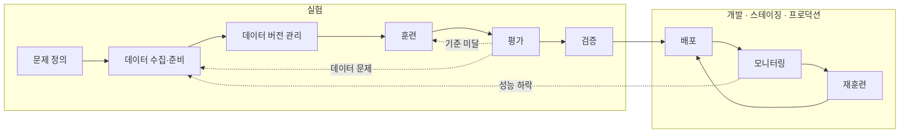
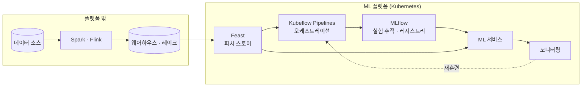
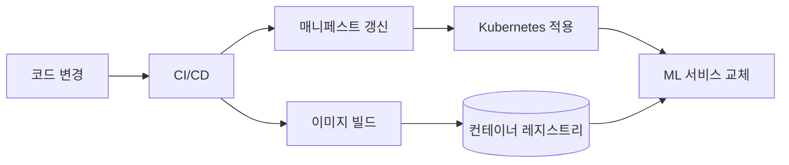

# CH1. MLOps와 ML 엔지니어링 시작

## 핵심 요약

- ML 프로젝트는 첫 배포로 끝나지 않는다. **실험**과 **운영** 두 구간을 계속 오가는 반복 작업이다.
- 반복을 버티려면 처음부터 단계를 **하나의 파이프라인으로 묶고**, 데이터·코드·설정·결과를 **함께 기록**해야 한다.
- 책은 Kubernetes 위에 Kubeflow Pipelines, Feast, MLflow를 하나씩 붙여 ML 플랫폼을 직접 만들고, 마지막에는 LLMOps로 넓힌다.

---

## 1. 머신러닝 수명주기

책은 수명주기를 두 구간으로 나눈다. 앞 구간은 "쓸 만한 모델을 찾는 일", 뒤 구간은 "그 모델을 운영에서 계속 쓸 만하게 유지하는 일"이다.

### 1.1 실험 구간

그림은 왼쪽에서 오른쪽으로 흐르지만 실제로는 거의 모든 화살표가 거꾸로도 흐른다. 평가 점수가 안 나오면 모델을 바꾸거나 데이터 단계로 돌아간다. 이렇게 되돌아가는 일이 잦기 때문에, 단계를 손으로 이어 붙이지 않고 **처음부터 파이프라인으로 만들어 두라**는 것이 이 장의 첫 번째 메시지다.

**문제 정의: ML이 꼭 필요한가부터 묻는다**

가장 먼저 할 일은 ML을 쓰지 않아도 되는지 확인하는 것이다. 키워드 몇 개로 거르는 스팸 필터, "최근 7일 인기순" 추천처럼 사람이 정한 규칙(휴리스틱)으로도 충분한 문제가 많다. 휴리스틱은 바로 동작하고 디버깅이 쉽다.

그래서 순서는 이렇게 잡는 것이 좋다고 이해했다.

1. 휴리스틱으로 baseline을 만들고 수치를 잰다.
2. ML 모델이 그 baseline을 **비즈니스 지표에서 의미 있게** 넘는지 본다.
3. 넘는 폭이 학습 파이프라인, 서빙, 모니터링을 운영하는 비용보다 클 때 ML을 택한다.

ML을 쓰기로 했다면 풀 문제를 구체적으로 적는다. "신분증 이미지에서 ID 번호를 뽑는다", "오탐을 줄이면서 부정 거래를 빨리 잡는다"처럼 입력과 출력, 무엇을 우선할지가 드러나야 한다.

**데이터 준비: 정답은 누군가 붙여야 한다**

지도학습에는 (입력, 정답) 쌍이 필요하다. 원본 데이터에는 정답이 없으니 사람이 붙이거나(애노테이션), 고객 신고처럼 업무 과정에서 자연스럽게 생긴 신호를 정답으로 쓴다. 실제 데이터가 부족하면 합성 데이터를 만들기도 한다.

여기서 운영 관점으로 기억해 둘 점이 두 가지 있었다.

- **운영에서는 정답이 늦게 온다.** 사기 거래는 신고까지 며칠이 걸린다. 정답이 없으니 운영 중인 모델의 정확도를 바로 잴 수 없고, 이것이 ML 모니터링이 어려운 근본 이유가 된다.
- **시간 순서가 있는 데이터는 무작위로 섞어 나누면 안 된다.** 미래 데이터가 훈련에 섞이면 평가 점수가 실제보다 좋게 나온다.

**데이터 버전 관리: 데이터도 코드처럼 동작을 바꾼다**

코드가 바뀌면 프로그램 동작이 바뀌듯, 데이터가 바뀌면 모델이 바뀐다. 같은 데이터와 같은 코드로 같은 모델이 나온다고 확신하려면 데이터에도 버전이 있어야 한다. 문제는 데이터 형태가 이미지, CSV, DataFrame 등 제각각이라 Git처럼 모두가 쓰는 표준 도구가 아직 없다는 점이다.

**훈련 · 평가 · 검증**

- **훈련**은 예측과 정답의 오차가 줄도록 가중치를 고치는 과정이다. 데이터셋과 전략이 정해지면 자동화할 수 있고, 자동화하면 파라미터와 결과물이 저절로 기록된다. 책은 "실제로는 훈련보다 나머지 일이 더 오래 걸린다"고 말한다.
- **평가**는 학습에 쓰지 않은 데이터로 정밀도, 재현율, AUC 같은 지표를 재는 일이다.
- **검증**은 비즈니스 쪽 사람이 "기대한 대로 동작하는가"를 확인하는 일이다. 평가가 숫자 확인이라면 검증은 쓰임새 확인에 가깝다.

### 1.2 운영 구간 (개발 · 스테이징 · 프로덕션)

이 구간으로 넘어오면 관심이 "더 좋은 모델 찾기"에서 "지금 모델이 계속 잘 돌게 하기"로 옮겨 간다. 보안, 확장성, 실시간 성능, 윤리 같은 조건이 우선순위에 올라온다.

실험 구간 파이프라인을 **CI나 API 호출로 시작되는 완전 자동 파이프라인**으로 바꾸고, 끝에 배포를 붙인다. 결과물은 보통 REST API로 노출되는 ML 서비스다.

| 단계 | 핵심 |
|---|---|
| 배포 | 컨테이너로 만들어 클라우드에 올리는 데서 끝나지 않는다. 부하 테스트, 오토스케일링, 버전 관리, 롤백 전략까지 포함한다 |
| 모니터링 | **시스템 지표**(RPS, 상태 코드), **ML 지표**(데이터·모델 드리프트), **비즈니스 지표**(이탈률 등) 세 층을 함께 본다 |
| 재훈련 | 주기(매월) 또는 조건(승인 건수 급감)으로 시작한다. 훈련만 자동이면 반쪽이고, **배포까지** 자동이어야 루프가 닫힌다 |

배포를 DevOps 팀에 넘기는 조직이라도 데이터 과학자가 배포에 참여하는 편이 낫다는 저자 의견도 인상적이었다. 모델을 만든 사람이 운영 환경의 제약을 알아야 다음 모델이 나아진다는 뜻으로 읽었다.

---

## 2. ML 엔지니어에게 필요한 역량

책이 꼽는 출발선은 네 가지다.

- **소프트웨어 엔지니어링**: 단순하지 않은 시스템을 실제로 배포해 보고, 성능 병목을 찾아 고쳐 본 경험
- **ML 이해**: 알고리즘 전문가일 필요는 없다. 주요 프레임워크를 다루고 낯선 프레임워크도 금방 익히는 수준
- **데이터 엔지니어링**: 현업에서 가장 어려운 일은 좋은 훈련 데이터를 충분히 모으는 것이다
- **자동화와 재현성**: 실수를 줄이고 피드백을 빠르게 한다. 규제나 감사 대상이면 재현성이 필수가 된다

처음부터 다 갖출 필요는 없고, 이 요소들이 어떻게 맞물리는지 이해하는 것이 먼저라는 것이 저자의 입장이다.

---

## 3. ML 플랫폼 구축

ML 플랫폼은 수명주기 각 단계에 필요한 도구를 한곳에 모아 둔 기반이다. 데이터 레이크나 Spark·Flink 같은 일반 데이터 시스템은 플랫폼 밖에 두고, 그 안쪽을 직접 만든다.

시작점은 Kubeflow이고, Kubeflow에 없는 기능(예: 피처 스토어)은 다른 오픈소스로 채운다. 책 전체에서 같은 구조도를 쓰면서 그 장에서 다루는 부분을 강조해 준다.

**직접 만들 필요가 있나?** SageMaker나 Vertex AI를 이미 쓰는 조직이라도, 직접 조립해 보면 각 부품이 어떻게 연결되는지와 매니지드 서비스가 막힐 때 어디를 보완해야 하는지 알게 된다는 것이 저자의 답이다. 저자는 "모든 상황에 맞는 아키텍처는 없다"고 하면서 점진적으로 키워 가라고 권한다. 도구도 정답이 아니라 출발점이므로 며칠짜리 PoC로 직접 써 보고 고르라고 한다.

**LLMOps로의 확장.** 지금 만드는 오케스트레이션·배포·모니터링 기반 위에 벡터 DB, 가드레일, 프롬프트 관리, 비용 최적화가 얹히는 구조다(12·13장). 기반 기술은 그대로 쓰인다.

---

## 4. 책에서 쓰는 도구: 각자 무엇을 막아 주나

도구 이름보다 **무엇이 잘못되는 것을 막아 주는지**로 정리하는 편이 기억에 잘 남았다.

### Kubeflow Pipelines: 단계 사이를 손으로 잇는 실수

수명주기의 각 단계를 컴포넌트로 만들고, 앞 컴포넌트의 출력을 다음 컴포넌트의 입력으로 넘긴다. 수작업 연결이 사라지니 같은 흐름을 몇 번이고 똑같이 다시 돌릴 수 있다.

### Feast: 훈련과 서빙이 서로 다른 값을 보는 문제

피처는 원본 데이터를 모델 입력용으로 가공한 값이다(예: 최근 7일 평균 결제액). 피처 스토어가 없으면 훈련용 계산 코드와 서빙용 계산 코드를 따로 짜게 되고, 둘이 조금만 달라도 **훈련-서빙 불일치(training-serving skew)** 가 생긴다. 피처 스토어는 정의를 한 곳에 두고 두 용도로 함께 제공한다.

- **오프라인 스토어**: 훈련·배치 추론용. 과거 이력 전체를 시점 기준으로 조회한다.
- **온라인 스토어**: 실시간 서빙용. 엔티티별 최신 값을 밀리초 단위로 돌려준다.
- **시점 기준(point-in-time) 조회**: 3월 1일 거래를 학습할 때 3월 1일까지 알 수 있었던 값만 가져온다. 앞에서 말한 "미래 정보 섞임"을 도구 차원에서 막아 준다.

내부적으로는 피처 서버(REST/gRPC), 피처 레지스트리(목록), 피처 스토리지(저장)로 나뉜다.

### MLflow: "그 모델 어떻게 만들었더라?"

훈련 한 번이 남기는 것은 모델 파일만이 아니다. 하이퍼파라미터, 손실 곡선 같은 그림, 데이터 버전과 커밋 해시 같은 메타데이터가 함께 남아야 나중에 같은 모델을 다시 만들 수 있다. MLflow는 이것들을 실행 단위로 기록하고, 모델 레지스트리에서 스테이징 → 프로덕션 승격을 관리한다.

헷갈리기 쉬운 용어는 "학습으로 얻느냐, 학습 전에 정하느냐"로 구분하면 된다. **가중치(파라미터)** 는 학습이 정하는 값이고 모델 파일에 저장된다. **하이퍼파라미터** 는 학습률이나 에폭처럼 사람이 미리 정하는 값이고 실행 기록에 남긴다.

### CI/CD + 컨테이너: 배포를 사람 손에서 떼어 내기

배포에서 고려할 축은 이식성(컨테이너), 확장성(복제본), 성능(GPU·CPU·메모리), 신뢰성이다.

> **DevOps 관점 메모**: 흐름만 보면 일반 서비스 배포와 거의 같다. 다른 점은 이미지 안의 코드뿐 아니라 **모델 아티팩트가 또 하나의 배포 입력**이라는 것, 그리고 배포 뒤에 **데이터 드리프트**까지 봐야 한다는 것이다.

---

## 정리하며

- "모델을 잘 만드는 법"보다 **"모델을 반복해서 다시 만들 수 있는 구조"** 를 먼저 만드는 것이 이 책의 방향이다.
- ML을 쓰기 전에 휴리스틱 baseline부터 만든다.
- 재현성은 코드만으로 생기지 않는다. 데이터, 설정, 결과물을 함께 기록해야 생긴다.
- 운영에서는 정답이 늦게 오기 때문에 모니터링을 시스템·ML·비즈니스 세 층으로 나눠 봐야 한다.
