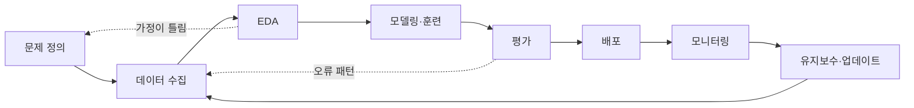
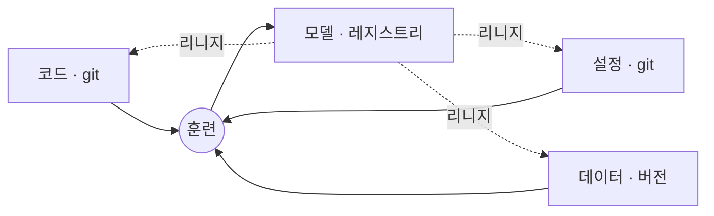
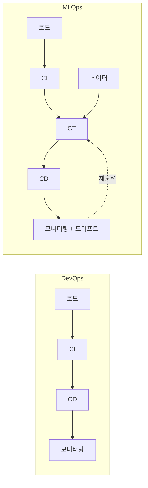

# CH2. MLOps란 무엇인가

## 핵심 요약

- 모델링 자체는 생각보다 쉽다. 어려운 것은 **비즈니스 가치, 요구사항, 인프라 사이의 간극**을 메우는 일이다.
- ML은 한 번 만들고 끝나는 프로젝트가 아니라 **계속 도는 루프**로 봐야 한다. 모델, 데이터, 하이퍼파라미터는 그 루프를 잠깐 지나가는 값이다.
- MLOps는 DevOps에 **데이터, 지속적 훈련(CT), 실험 추적, 드리프트 감시**가 더해진 분야다. 성숙도는 "무엇을 자동으로 배포하느냐"로 가늠한다.

---

## 들어가며: 진짜 어려운 질문은 모델을 고른 다음에 나온다

모델 연구를 직접 하는 회사는 드물다. 대부분 Hugging Face 같은 곳의 기성 모델을 자기 데이터에 맞게 다시 학습시킨다. 그래서 아키텍처를 고르는 것까지는 의외로 금방 끝나고, 그다음 질문들이 진짜 일이 된다.

- 훈련은 어디서, 어떻게 돌리나?
- 데이터는 어떤 경로로 모델에 들어가나?
- 다른 서비스와는 어떻게 붙나?
- 어디서 실행하나?
- 시간이 지나도 정확도를 어떻게 지키나?

이 장은 이 질문들을 루프 하나로 묶어 보고, DevOps와 비교한 뒤, 조직이 어느 단계까지 와 있는지 재는 기준(성숙도)으로 마무리한다.

---

## 1. ML 루프



루프로 보는 이유는 단순하다. 운영에서는 모델이 아주 자주 바뀐다. 중고차 가격 예측 모델을 예로 들면, 시장이 바뀌면 다시 학습해야 하고, 상용차용 모델이 따로 생기기도 한다. 바뀔 때마다 배포 절차를 새로 고민하면 정작 모델 개선에 쓸 시간이 없다. 루프를 미리 만들어 두면 팀이 여러 개여도 같은 방식으로 돌릴 수 있다.

### 1.0 문제 정의: 이해관계자와 같이 정한다

"이탈률을 예측하라" 한 문장으로는 무엇을 맞혀야 하고 무엇으로 평가할지 정할 수 없다. 책은 세 그룹이 각자 답해야 할 질문을 나눠 둔다. 내 방식으로 요약하면 이렇다.

| 그룹 | 결국 답해야 하는 것 |
|---|---|
| 비즈니스·제품 | 왜 ML인가, 성공을 무엇으로 재나, 틀리면 얼마나 손해인가, 언제까지인가 |
| 기술 | ML로 풀 수 있나, 데이터는 어디 있나, 어떤 지표로 평가하나, 언제 다시 학습하나 |
| 법무·컴플라이언스 | 개인정보·윤리 문제는 없나, 민감 데이터를 어떻게 다루나 |

이 질문들에 미리 답해 두면 범위가 분명해지고, 위험을 일찍 발견하고, 데이터 과학자와 엔지니어가 같은 목표를 보게 된다.

### 모델과 코드는 따로 움직인다

이 장에서 가장 중요하게 읽은 문장은 **"모델(가중치 + 네트워크)과 코드(아키텍처 + 지원 코드)는 별개의 개체"** 라는 부분이다.

- 코드는 그대로인데 새 데이터로 다시 학습해 모델만 바뀔 수 있다.
- 모델 파일은 그대로인데 전처리 코드만 바뀔 수도 있다.
- 둘이 맞지 않는 버전끼리 만나면 에러가 나거나, 더 나쁘게는 **에러 없이 틀린 결과**가 나온다.

```python
model = SmallNet()                               # 구조는 코드가 만든다
model.load_state_dict(torch.load("weights.pt"))  # 숫자는 모델 파일에서 온다
```

그래서 "어느 모델이 어느 코드, 어느 데이터와 짝인가"를 기록한 **리니지**가 필요하다.

#### 리니지(lineage)란

lineage는 원래 "혈통, 계보"라는 뜻이다. ML에서는 **어떤 결과물(데이터셋, 모델, 예측)이 무엇으로부터, 어떤 과정을 거쳐 만들어졌는지를 이어 놓은 기록**을 말한다. 쉽게 말해 모델의 족보다.


각 화살표가 리니지의 한 고리다. 고리마다 "무엇을 입력으로 썼고, 무엇을 만들었고, 그때 버전과 설정은 무엇이었나"를 남긴다. 이 고리들이 끊기지 않고 이어져 있어야 모델 v7 하나만 보고도 맨 왼쪽 원천 데이터까지 거슬러 갈 수 있다.

1장에서 본 **재현성**과 헷갈리기 쉬워서 구분해 두면 이렇다.

- **재현성**은 "같은 조건이면 같은 결과가 나온다"는 **성질**이다.
- **리니지**는 그 "같은 조건"이 정확히 무엇이었는지 알려 주는 **기록**이다.

리니지가 없으면 재현하고 싶어도 무슨 조건이었는지 모른다. 그래서 재현성은 리니지 위에서만 성립한다. 책에서는 MLflow의 실험 추적과 모델 레지스트리, 데이터 버전 관리가 이 기록을 남기는 역할을 맡는다.

리니지는 두 방향으로 쓴다.

- **위로 거슬러 올라가기**: 운영 모델이 이상하다 → 이 모델은 어떤 데이터·코드·설정으로 만들었나?
- **아래로 내려가기**: 3월 데이터에 오류가 있었다 → 그 데이터로 만든 모델은 어느 것이고 지금 어디에 떠 있나?

기록(유지)이 없으면 조회(추적)도 없다. 그리고 리니지는 프로젝트 초반에 가장 쉽게 생략되는 것이라 그대로 **기술 부채**가 된다.

> 참고: pickle로 저장된 모델은 로드할 때 코드가 실행될 수 있다. 출처를 모르는 모델 파일은 바로 열면 안 된다.

### 1.1 데이터 수집: 여기서 생긴 문제는 끝까지 따라온다

모델은 받은 데이터가 세상의 전부라고 믿고 배운다. 그래서 수집 단계의 치우침은 뒤에서 아무리 학습을 잘해도 고쳐지지 않는다.

연구와 실무의 차이도 여기서 나온다. 연구는 이미 잘 정리된 공개 데이터셋을 쓰고 지표 올리기에 집중한다. 실무는 내 도메인에 맞는 공개 데이터가 거의 없고, 있더라도 내 운영 환경 데이터로 다시 맞춰야(파인튜닝) 한다. 사실상 데이터셋을 직접 만드는 일에 가깝다.

데이터를 모을 때 경계할 것은 두 가지로 정리했다.

| | 편향 | 누수 |
|---|---|---|
| 한 줄 정의 | 데이터가 현실과 다르다 | 평가가 현실과 다르다 |
| 대표 예 | 밝은 실내 사진만 모음 / 신고된 사기만 사기로 표시 | 같은 샘플이 훈련·테스트 양쪽에 / 미래 값을 피처로 사용 |
| 증상 | 특정 상황에서만 계속 틀림 | 평가 점수는 좋은데 배포하면 떨어짐 |
| 막는 법 | 운영 환경을 골고루 담고, 그룹별로 따로 성능 측정 | 분할 전 중복 제거, 시간 순 분할, "예측 시점에 이 값을 알 수 있나?" 자문 |

균형 조정(소수 클래스 늘리기)은 **훈련 데이터에만** 해야 한다는 점도 메모해 둔다. 테스트 데이터까지 손대면 실제보다 좋아 보인다.

리니지가 데이터 단계에서 주는 이득은 **고치는 비용**이다. 데이터셋 첫 버전이 최선인 경우는 거의 없다. 한 달 뒤 "3월 데이터에 중복이 있었다"는 걸 알았을 때, 어떤 원본에서 어떤 조건으로 뽑았는지 기록이 있으면 조건만 고쳐 쿼리 한 번으로 다시 만든다. 기록이 없으면 추출 스크립트를 처음부터 다시 짜야 한다.

**프로젝트별 데이터**

- **신분증 탐지 – MIDV-500**: 50종 신분 문서를 스마트폰으로 찍은 영상 500편. 견본 문서라 개인정보 문제가 없고, 프레임마다 문서 모서리 좌표가 정답으로 들어 있다.
  - 사람 애노테이션 체험용으로 **CVAT**를 다룬다. 사람이 박스를 그리고, 모델이 다음 박스를 제안하면, 사람이 고친다. 이 반복(human-in-the-loop)에서 생기는 속도, 기준 불일치, 레이블 버전 관리 문제를 직접 겪어 보는 것이 목적이다.
  - 실제 학습에는 **합성 데이터**를 쓴다. 프로그램이 신분증을 배경에 붙여 이미지를 만들면 위치를 이미 알고 있으니 정답이 자동으로 생긴다.
- **영화 추천 – MovieLens 1M**: 사용자 약 6,000명, 영화 약 3,000편, 평점 100만 건. 데이터를 일부러 여러 조각으로 나눠 하나씩 추가하면서 "운영 중에 데이터가 계속 들어오는 상황"을 흉내 낸다. 데이터셋 버전 관리가 여기서 시작된다.

세 프로젝트는 이미지, 테이블, 텍스트로 **모달리티**가 모두 다르다. 같은 원칙(품질, 편향, 리니지)이 데이터 형태에 따라 어떻게 다르게 적용되는지 보여 주려는 구성이다.

### 1.2 EDA: 가정을 검증하는 단계

EDA는 데이터의 생김새(스키마, 분포, 이상값, 주기성)를 확인하는 단계다. 책은 이 단계를 **정의가 덜 된 문제를 거르는 첫 방어선**이라고 부른다.

내가 가장 중요하게 본 문장은 **"모든 가정은 검증되기 전까지 리스크다"** 이다. "이 필드는 절대 null이 아니다", "샘플링은 고르게 됐다" 같은 가정을 파이프라인 앞단에서 자동으로 검사해 두면, 나중에 장애가 났을 때 원인 범위를 금방 좁힐 수 있다. 인프라에서 입력 검증을 앞단에 두는 것과 같은 발상이다.

변수가 많을 때는 여러 변수를 함께 보는 다변량 분석, 고차원을 2~3차원으로 줄여 보는 PCA·t-SNE를 쓴다. PCA는 빠르고 결과가 일정하지만 선형 구조만 잡는다. t-SNE는 군집을 보기 좋지만 실행마다 결과가 다르고 군집 사이 거리는 의미가 없다.

### 1.3 모델링과 훈련: 모델은 "코드 + 설정 + 데이터"의 결과물

문제 유형(분류, 탐지, 회귀)과 입력 타입으로 모델을 고른다. 이 단계에서 MLOps 도구상자가 본격적으로 등장한다.

- **모델·데이터 버전 관리**: 모델마다 어떤 데이터 버전으로 학습했는지 묶어 둔다.
- **실험 추적**: 프로토타입 단계의 실험까지 설정, 체크포인트, 결과를 남긴다. 실험이 사라지지 않는다.
- **훈련 파이프라인**: 수작업 단계를 없앤다.
- **하이퍼파라미터 탐색**: 범위와 목표를 주면 도구가 조합을 찾아 준다.

이 도구들이 제대로 돌려면 코드베이스가 **모듈식**이어야 한다. 학습된 모델을 "코드에 설정과 데이터를 넣고 돌린 결과물(아티팩트)"로 보는 관점이다.



이렇게 나눠 두면 과적합이 의심될 때 코드를 고치지 않고 설정에서 층 수만 줄여 다시 돌리면 된다. 설정이 git에 있으니 두 모델의 차이를 diff로 바로 볼 수 있다.

다만 **설정으로 다 빼는 것도 함정**이다. 쓰지도 않을 옵션을 수백 개 만들면 오히려 무엇을 바꿔야 할지 모르게 된다. 단순하게 시작해서 실제로 바꿔 보고 싶은 값이 생길 때 하나씩 설정으로 옮긴다.

**프로젝트별 모델**

- **신분증 탐지**: YOLO는 COCO 데이터셋(객체 91종)으로 학습돼 신분증을 모른다. 레이블된 데이터로 파인튜닝해서 신분증 탐지기로 만든다. 책은 YOLOv8을 쓴다.
- **영화 추천**: 단순한 baseline부터 시작한다. 노트북 → 재훈련 파이프라인 → 추적 서버 순으로 키우고, 모니터링 이후 더 복잡한 모델을 운영 모델과 나란히 비교한다.
- **RAG**: 임베딩 모델, 벡터 DB, 채팅 UI가 새로 붙지만 MLOps 뼈대는 그대로다.

### 1.4 평가: 어떤 지표를 쓰느냐가 곧 문제 정의다

분류·탐지는 정밀도·재현율·F1, 회귀는 MAE·MSE가 기본이다. 하지만 어떤 지표를 앞세울지는 도메인이 정한다. 의료는 오진(위양성)을 줄이려 정밀도 기준을 엄격하게 두고, 금융은 놓친 사기가 곧 손실이라 재현율을 중시하기도 한다.

정확도만 보면 안 되는 이유도 짚고 넘어가자. 스팸이 10%뿐인 메일함에서 "전부 정상"이라고 찍기만 해도 정확도는 90%가 나온다. F1은 정밀도와 재현율의 조화평균이라 둘 중 하나만 낮아도 크게 떨어지고, 그래서 불균형 데이터에서 더 정직하다.

**홀드아웃 데이터셋**은 학습에 절대 쓰지 않는 최종 시험지다. 운영 데이터를 닮게 만들고, 평가는 자동으로 돌리고, 훈련 데이터만큼 엄격하게 버전을 관리한다. 분할 기준이 바뀌면 이전 점수를 믿을 수 없게 되므로 재평가와 재훈련이 필요해진다.

평가는 점수만 내는 단계가 아니다. 틀린 샘플을 모아 패턴을 찾고, 그 결과를 데이터 수집 단계로 되돌려 보낸다. 적대적 테스트나 에지 케이스 시뮬레이션으로 견고성도 확인한다. 해석 가능성(SHAP, LIME 등)은 강력하지만 구현 비용이 크니 요구사항을 보고 판단하라고 한다.

### 1.5 배포: 최적화한 그 모델로 다시 테스트한다

배포 형태는 크게 두 가지다.

- **API 엔드포인트**: 마이크로서비스 안에서 API 계층 뒤에 모델을 둔다. 가장 흔하다.
- **에지 디바이스**: 자동차, 보안 장비, 로봇처럼 기기 안에서 바로 판단해야 하는 경우

어느 쪽이든 배포 전에 양자화 같은 **최적화**를 하는 경우가 많다. 여기서 놓치기 쉬운 점은 **최적화한 최종 모델로 성능을 다시 재야 한다**는 것이다. GPU에서 통과한 모델도 임베디드 가속기에서는 다르게 동작할 수 있다.

배포는 **스테이징 → 프로덕션** 두 단계로 나누는 것이 일반적이다. 스테이징 모델을 운영 모델과 나란히 평가하고, 통과하면 자동으로 승격한다. 리니지와 버전이 잘 남아 있으면 롤백은 "운영 모델을 이전 버전으로 가리키게 하는 것"으로 끝난다.

책의 스택은 이렇다.

- 신분증·추천 프로젝트: **BentoML**로 HTTP 서빙 → Docker 이미지 → **Yatai**로 배포
- RAG: **Chainlit**으로 채팅 UI
- BentoML은 RPS, 응답 코드 같은 **Prometheus 지표**를 기본으로 내보낸다.
- 이후 배칭, 카나리 배포, A/B 테스트도 다룬다.

### 1.6 모니터링: 알림이 사람에게 닿아야 완성이다

운영 중인 모델은 입력 데이터 변화, 개념 드리프트(입력과 정답의 관계 자체가 바뀜), 하드웨어·소프트웨어 장애로 조용히 나빠진다. 책은 모니터링을 세 종류로 나눈다.

- **데이터 모니터링**: 들어오는 입력의 통계가 훈련 때와 달라졌나(데이터 드리프트)
- **성능 모니터링**: 정확도 같은 지표가 시간이 지나며 떨어지나
- **오류 모니터링**: 틀린 예측을 모아 어떤 경우에 틀리는지 분석

모니터링은 혼자 서지 못한다. 모델 버전이 있어야 "어느 모델이 나빠졌나"를 알고, 로그가 있어야 에지 케이스를 재현할 수 있다. 그리고 지표와 로그를 다 갖춰도 **알림이 담당자에게 가지 않으면 없는 것과 같다**는 문장은 운영하는 사람으로서 가장 공감한 부분이다.

드리프트를 감지해 재훈련을 시작시키는 도구로 **Evidently**가 새로 등장한다.

### 1.7 유지보수와 업데이트: 루프를 닫는 단계

모니터링 결과를 받아 버그를 고치고, 약한 케이스의 데이터를 더 모으고, 드리프트에 맞춰 재학습한다. 책은 이 단계를 루프의 마지막 칸이 아니라 **모든 단계에 퍼져 있는 활동**으로 보라고 한다. 배포 단계에는 "운영 모델 교체"가, 데이터 수집 단계에는 "드리프트 대응"이 유지보수로 들어 있다.

프로젝트에서는 이렇게 이어진다.

- 신분증 탐지: 학습 때 못 본 신분증이 들어오면 모니터링에 잡히는가?
- 영화 추천: 사용자 데이터를 더 넣어 드리프트 알림을 받고, 새 아키텍처를 운영 모델과 비교해 교체 여부를 정한다.
- RAG: **Langfuse**로 LLM 관측 가능성을 보고, 가드레일, 입력 정제, 프롬프트 안정화, 환각 테스트를 다룬다.

---

## 2. MLOps는 왜 어려운가

책이 꼽은 이유를 세 묶음으로 다시 정리했다.

**시스템이 크다.** 수집, 애노테이션, 버전 관리, EDA, 훈련, 배포, 모니터링이 각각 하나의 전문 분야다. 다 갖추면 움직이는 부품이 너무 많아서 구조적인 결함이 어디 있는지 보기 어려워진다. 여기에 도구도 파편화돼 있다. 모델 레지스트리 하나만 해도 선택지가 열 개가 넘고, 하나로 다 되는 솔루션은 드물다. 그래서 현재는 전문 도구 몇 개와 포괄 솔루션 하나를 조합하는 방식이 주류다.

**사람들이 서로 다른 말을 쓴다.** 데이터 과학자는 정밀도와 F1을, ML 엔지니어는 레지스트리와 지연 시간과 스케일링을 이야기한다. 같은 언어가 없으면 루프가 돌지 않는다.

**현실은 지저분하다.** 실세계 데이터의 에지 케이스는 에러를 내거나, 더 나쁘게는 **조용히** 결과를 왜곡한다. 최적화하면 성능 특성이 달라지고, 수백만 요청을 처리하는 것은 평가 스크립트를 돌리는 것과 전혀 다른 문제다. 개인정보, 보안, 공정성, 규제 요건도 데이터 위에 겹겹이 얹힌다.

그래서 작은 팀은 MLOps를 건너뛰고 빨리 만드는 쪽을 고르기 쉽다. 모델 하나, 단기적으로는 그게 맞을 수도 있다. 하지만 모델이 늘어나면 그 선택이 그대로 기술 부채가 된다.

---

## 3. 성숙한 조직에서 MLOps가 하는 일

잘 갖춘 MLOps가 조직에 주는 것을 한 문장으로 줄이면 **"올바른 습관을 기본값으로 만든다"** 이다. 예를 들어 훈련 코드에 로깅이 이미 들어가 있으면, 데이터 과학자는 따로 신경 쓰지 않아도 실험이 기록된다.

그 결과로 책은 이런 이점을 든다.

- 인프라가 추상화돼 데이터 과학자가 가설 검증과 모델 개선에 집중한다.
- 팀마다 따로 만들던 파이프라인과 인프라를 공유해 비용과 중복이 준다.
- 표준 도구 덕분에 팀 간 협업과 가시성이 좋아진다.
- 반복 작업이 자동화돼 사람 실수가 줄고 결과가 일정해진다.
- 모델 변화가 보이고, 문제가 생기면 디버깅·롤백 경로가 있다.
- 대규모 데이터 처리와 스케일링을 공통 방식으로 다룬다.

---

## 4. DevOps vs MLOps

DevOps를 하는 입장에서 가장 궁금했던 부분이다. 왜 MLOps를 DevOps의 확장이 아니라 별도 분야로 부르는가.

**같은 점**은 익숙하다. 자동화로 반복 작업을 없애고, CI/CD로 테스트와 배포를 자동으로 돌리고, 여러 분야를 아는 제너럴리스트가 필요하다.

**다른 점**은 결국 "코드 말고도 시스템을 바꾸는 것이 있다"로 모인다.

| 관점 | DevOps | MLOps |
|---|---|---|
| 무엇이 시스템을 바꾸나 | 코드 | 코드 **+ 데이터** |
| 코드가 그대로면 | 동작도 그대로 | 데이터가 바뀌면 모델이 바뀜 → **CT(지속적 훈련)** 필요 |
| 무엇을 추적하나 | 빌드 | **실험** |
| 어떻게 망가지나 | 에러, 장애 | 입력 분포가 바뀌어 **조용히** 나빠짐 |
| 추가 관심사 | | 해석 가능성, 편향 |



> **DevOps 관점 메모**: 5xx도 없고 지연 시간도 정상인데 예측만 틀리는 장애가 MLOps에서 새로 생기는 장애 유형이다. 이를 잡으려면 기존 시스템 지표 대시보드에 **입력 분포와 예측 분포 지표**가 더해져야 한다.

---

## 5. MLOps 성숙도 (Google 기준)

Google은 루프 각 단계가 **얼마나 자동화돼 있는가**로 성숙도를 나눈다. 이걸 "무엇을 배포하느냐"로 바꿔 보면 차이가 선명해진다.


- **Level 0 (기초)**: 스크립트를 손으로 돌려 모델을 만들고 배포한다. 모니터링이 없고 릴리스도 드물다. 대부분의 조직이 여기서 시작한다.
- **Level 1 (중급)**: 모델이 아니라 **재훈련 파이프라인**을 운영에 배포한다. 새 데이터가 들어오면 운영에서 알아서 다시 학습한다(CT). 개발과 운영이 같은 파이프라인을 쓰는 것을 **실험-운영 대칭성**이라고 부른다. 이를 위해 데이터·모델 검증, 피처 스토어(필요 시), 메타데이터·리니지, 트리거 기반 실행이 필요하다.
- **Level 2 (고급)**: 파이프라인 자체를 CI/CD로 빌드하고 배포한다. 데이터·모델 분석 말고는 거의 다 자동이고, 파이프라인은 ML 엔지니어 개인이 아니라 조직이 함께 소유한다. 데이터 과학자도 새 컴포넌트를 제안할 수 있다.

레벨 사이 난이도가 일정하게 오르는 것은 아니지만, 지금 어디 있는지 알면 다음에 무엇을 갖출지 정하기 쉽다.

참고: [Google Cloud – MLOps: 머신러닝의 지속적 제공 및 자동화 파이프라인](https://cloud.google.com/architecture/mlops-continuous-delivery-and-automation-pipelines-in-machine-learning)

---

## 정리하며

- ML은 **루프**다. 모델이 바뀌는 것을 전제로 프로세스를 짠다.
- **모델과 코드는 따로 움직인다.** 둘을 잇는 리니지는 처음부터 남겨야 하고, 미루면 기술 부채가 된다.
- 편향은 데이터가, 누수는 평가가 현실과 다른 문제다. 둘 다 **데이터 단계에서** 막는다.
- 모델은 **코드 + 설정 + 데이터의 결과물**이다. 이렇게 나눠야 실험이 빨라지고 재현된다.
- MLOps는 DevOps에 **데이터와 CT, 실험 추적, 조용한 장애 감시**가 더해진 것이다.
- 다음 장부터 Kubernetes로 이 루프를 실제로 올린다.
