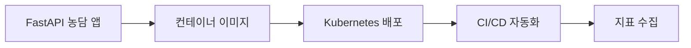

# CH3. 쿠버네티스 기초

## 핵심 요약

- 3장에는 ML 이야기가 거의 없다. **무작위 농담을 돌려주는 FastAPI 앱** 하나로 컨테이너 → Kubernetes 배포 → CI/CD → 지표 수집까지 한 바퀴 돈다.
- 평소 DevOps 업무와 겹치는 내용이라 상세 정리는 생략하고, 흐름과 **뒤 장과의 연결점**만 남긴다.

---

## 1. 이 장에서 하는 일

| 단계 | 하는 일 |
|---|---|
| 앱 | 요청하면 무작위 농담을 돌려주는 간단한 FastAPI 서비스 |
| 이미지 | 앱을 컨테이너 이미지로 만든다 |
| Kubernetes | 이미지를 클러스터에 배포하고 서비스로 노출한다 |
| CI/CD | 코드 변경 → 빌드 → 배포를 자동화한다 |
| 지표 | 서비스에 지표를 붙여 상태를 볼 수 있게 한다 |

---

## 2. ML 없는 앱으로 시작하는 이유

농담 앱을 **모델 서빙 API**로 바꿔 놓고 보면 뒤 장의 배포 구조와 같다. 바뀌는 것은 응답을 만드는 로직뿐이다.

| 3장 (농담 앱) | 이후 장 (ML 서비스) |
|---|---|
| 농담 목록에서 무작위로 선택 | 모델이 입력을 받아 예측 |
| 코드만 이미지에 포함 | 코드 + **모델 아티팩트** |
| 코드가 바뀔 때 배포 | 코드가 바뀔 때 **또는 모델이 다시 학습됐을 때** 배포 |
| 요청 수, 응답 코드, 지연 시간 | 위 지표 + **입력·예측 분포(드리프트)** |

인프라 뼈대(이미지, 배포, 자동화, 지표)를 ML 없이 먼저 세워 두고, 다음 장부터 그 위에 Kubeflow와 ML 컴포넌트를 올리는 순서다.

---

## 3. 뒤 장과 이어지는 지점

- **1장 배포 흐름**: 코드 변경 → 이미지 빌드 → 레지스트리 푸시 → 매니페스트 적용. 3장이 이 흐름을 처음 직접 구현하는 장이다.
- **2장 모니터링**: 2장에서 말한 "시스템 지표" 층(RPS, 응답 코드)을 여기서 먼저 붙인다. ML 지표는 그 위에 더해진다.
- **2장 성숙도 Level 2**: 파이프라인 자체를 CI/CD로 배포하려면 이 장의 CI/CD가 출발점이 된다.

---

## 정리하며

- 3장은 ML 플랫폼을 올리기 전에 까는 **인프라 기초 실습**이다.
- 앱만 모델로 바꾸면 이후 ML 서비스의 배포·자동화·모니터링 구조가 그대로 이어진다.
- DevOps 입장에서 새로 챙길 것은 이 장 자체보다, 뒤 장에서 **모델 아티팩트와 데이터 지표가 같은 파이프라인에 어떻게 끼어드는지**다.
