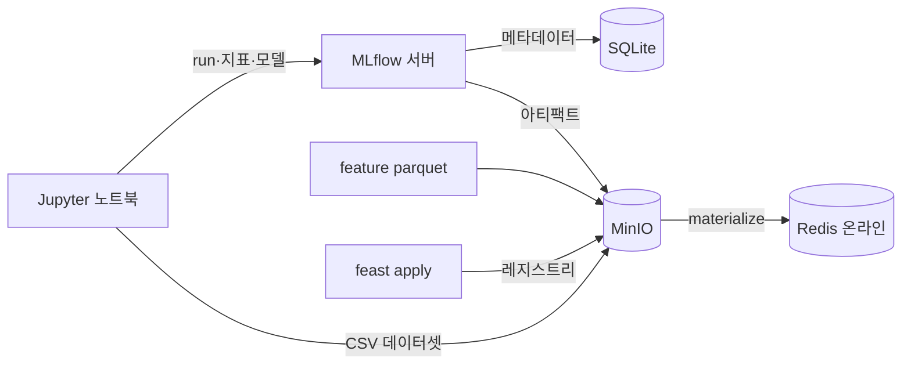
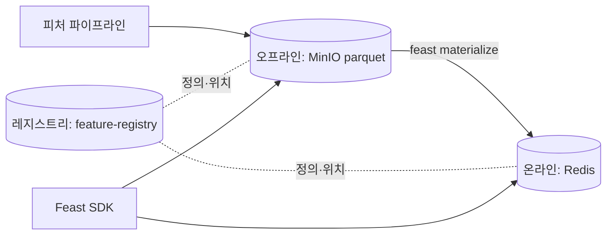

# CH4. 신뢰할 수 있는 ML 시스템 설계: MLflow와 Feast

## 핵심 요약

- 4장은 소득 구간(**5만 달러 이하 / 초과**)을 맞히는 **이진 분류기** 하나를 만들면서, 임시방편 실험을 재현 가능한 워크플로로 바꾸는 도구 두 개를 붙인다.
- **MLflow**는 실험 추적과 모델 레지스트리를 맡는다. 어떤 데이터와 파라미터로 만든 모델인지 기록하고, 가장 좋은 모델을 이름 붙여 저장한다.
- **Feast**는 피처 스토어다. 학습과 추론이 **같은 피처를, 같은 시점 기준으로** 꺼내 쓰게 해 준다.
- 저장소는 둘로 나뉜다. 오프라인(MinIO의 parquet)은 학습과 배치용, 온라인(Redis)은 실시간 추론용이다.
- 실습에서 실제로 막힌 곳은 **MLflow 3.0 + 책 코드의 불일치**(XGBoost 등록 실패, autolog 경고)와 **포트·엔드포인트 차이**였다.

---

## 들어가며: 왜 이 두 도구인가

1장의 플랫폼 지도에서 이번 장이 채우는 칸은 피처 스토어(D), 실험 추적(C), 모델 레지스트리(B)다. 모델을 프로덕션에 올리기 전에 먼저 답할 수 있어야 하는 질문이 있다.

- 지금 프로덕션에 있는 모델은 어떤 버전인가?
- 어떤 파라미터가 가장 좋은 결과를 냈는가?
- 6개월 전 결과를 다시 만들 수 있는가?
- 학습할 때 쓴 피처와 추론할 때 쓰는 피처가 같은가?

앞의 세 질문은 MLflow가, 마지막 질문은 Feast가 답한다.



---

## 1. 실습 환경

### 1.1 구성

| 컴포넌트 | 역할 | 비고 |
|---|---|---|
| MinIO | S3 호환 객체 스토어 | 데이터셋, 아티팩트, Feast 오프라인 데이터와 레지스트리 |
| Redis | Feast 온라인 스토어 | 암호 인증 켜서 운영 |
| MLflow 서버 | 추적 서버 + 모델 레지스트리 | 백엔드 SQLite, 아티팩트는 S3(MinIO) |
| JupyterLab | 실험 노트북 실행 | venv 커널(`chapter-4`)로 등록 |
| uv | 파이썬 환경 관리 | `uv venv --python 3.11`, `uv pip install -r requirements.txt` |

- 책의 실습 저장소(`practical-mlops/chapter-4`)는 `mlflow==3.0.0`을 쓴다. 책 본문은 2.6.0과 `mlflow ui`를 말하지만 **저장소 버전에 맞춘다**.
- `sqlalchemy>=2.0,<2.1`로 고정해야 한다. 2.1.x에서는 MLflow 3.0.0 서버가 `FallbackAsyncAdaptedQueuePool` import 오류로 뜨지 않는다.
- 노트북이 커널을 제대로 잡도록 `python -m ipykernel install --user --name ... --display-name ...`로 venv의 파이썬을 명시 등록한다. `-m`을 붙여야 활성화한 venv의 경로가 `kernel.json`에 기록된다.

### 1.2 환경 두 가지

| | 서버(k3s) 방식 | 로컬 PC(Docker Compose) 방식 |
|---|---|---|
| MinIO | Kubeflow의 `minio-service`를 재사용 (NodePort) | 컨테이너 직접 기동 (9000/9001) |
| Redis | k8s StatefulSet (NodePort 30006) | 컨테이너 직접 기동 (6379) |
| 접속 | 노트북에서 NodePort로 접근 (책의 `port-forward` 불필요) | `localhost` |
| 주의 | 책 코드의 `localhost:9000`을 NodePort로 **사본에서만** 수정 | macOS는 AirPlay 수신이 5000을 점유하므로 끄고 사용 |

원본 노트북은 건드리지 않고 사본에서 엔드포인트만 바꿔 쓰는 것이 편하다.

### 1.3 버킷 4개

| 버킷 | 쓰는 쪽 | 내용 |
|---|---|---|
| `mlflow-datasets` | 노트북(minio SDK) | 전처리된 특성·학습·테스트 CSV |
| `mlflow-artifacts` | MLflow `log_*` | run별 모델 파일, 플롯 |
| `feature-data-sets` | Feast 오프라인 스토어 | demographic, relationship, occupational parquet 3개 |
| `feature-registry` | `feast apply` | `registry_local.db` (엔티티·피처 뷰 메타데이터) |

- `mlflow-datasets`는 **이름이 코드에 박혀 있다**. 노트북이 `bucket_exists("mlflow-datasets")`로 확인하므로 이름을 바꾸면 코드도 고쳐야 한다.
- 책 본문의 `feature_data_sets`(밑줄)는 오기다. 밑줄은 버킷 이름에 쓸 수 없어서 코드는 하이픈을 쓴다.
- `feature_store.yaml`을 `feature-registry`에 올리면 Redis 암호가 평문으로 버킷에 들어간다. 올리지 않는 편이 낫다.

### 1.4 MLflow 서버 기동

```bash
mlflow server --host 127.0.0.1 --port 5000 \
  --backend-store-uri sqlite:///mlflow.db \
  --default-artifact-root s3://mlflow-artifacts/chapter-4 \
  --no-serve-artifacts
```

- 메타데이터(run, 지표)는 SQLite, 파일(모델, 플롯)은 S3에 나뉘어 저장된다.
- **아티팩트는 서버가 아니라 노트북(클라이언트)이 MinIO에 직접 올린다.** 그래서 노트북 쪽에도 `AWS_ACCESS_KEY_ID`, `AWS_SECRET_ACCESS_KEY`, `MLFLOW_S3_ENDPOINT_URL`(또는 `AWS_ENDPOINT_URL`)이 필요하다.
- 계정은 파일에 쓰지 않고 `.env`나 k8s Secret에서 읽어 환경변수로 넘긴다.
- 서버와 Jupyter를 `systemd --user` 서비스로 올려 두면 재기동이 편하다. 단, LAN에 `0.0.0.0`으로 열면 **MLflow는 인증이 없고 Jupyter는 서버에서 코드를 실행**할 수 있으니 신뢰하는 네트워크에서만 쓴다.

---

## 2. MLflow로 실험 추적하기 (4.1)

### 2.1 왜 추적 서버인가

파라미터를 git 커밋이나 파일로 관리하는 방법도 있지만, 커밋마다 태그를 달고 파일 사용법을 따로 설명해야 한다. 추적 서버는 **재현성, 모델 선택, 성능 추적** 세 가지를 한곳에서 해결한다.

### 2.2 데이터 탐색(EDA)

| 항목 | 값 |
|---|---|
| 데이터 | Adult/Census Income, 30,162행 × 9컬럼 |
| 특성 | Workclass, Education, Marital-Status, Occupation, Relationship, Race, Sex, Native_country (**전부 범주형**) |
| 정답 | `Target` (`<=50K` / `>50K`), `>50K`가 약 25% |

- `describe`는 컬럼별 고유값 수와 최빈값을 보여 준다.
- 범주형 8개를 `geom_bar(position='fill')`로 그려 **값별 고소득 비율**을 비교한다. `fill`은 막대를 100%로 맞춰 비율을 보게 하고, `stack`은 건수를 쌓는다. (도전과제: 둘을 바꿔 비교해 보기)
- 이 EDA 루프를 `mlflow.start_run(run_name=f"eda-{uuid}")` 안에 넣고 `mlflow.log_artifacts("categorical_variable_plots")`를 호출하면 플롯이 run의 Artifacts에 저장된다. 저장 위치는 `s3://mlflow-artifacts/chapter-4/<실험ID>/<run ID>/artifacts/`다.

참고: 플롯을 다 만든 뒤에야 업로드가 일어나서, 루프 중간에 예외가 나면 아티팩트 없이 run만 `FAILED`로 남는다. 로컬 폴더에 예전 파일이 있으면 그것도 같이 올라간다.

### 2.3 전처리와 분할

```python
target = encoder.fit_transform(np.array(df.Target).reshape(-1, 1))   # OneHotEncoder(drop="if_binary")
dummyfied_df = pd.get_dummies(feature_df, drop_first=True, sparse=False, dtype=float)
X_train, X_test, y_train, y_test = train_test_split(dummyfied_df, target, train_size=0.80, shuffle=True)
```

| 처리 | 결과 |
|---|---|
| 정답 인코딩 | `<=50K`=0, `>50K`=1 (평균 약 0.249) |
| 더미 변환 | 고유값 합 98개 − 8개(`drop_first`) = **90개 컬럼** |
| 분할 | 학습 24,129 + 평가 6,033 = 30,162 |
| `column_list.pkl` | 더미 컬럼 이름·순서를 저장. 추론 때 같은 90컬럼을 같은 순서로 만들기 위해 |

- 컬럼 이름에 공백이 들어 있다(`Workclass_ State-gov`). 원본 CSV 값 앞에 공백이 있기 때문이다. 이름으로 찾을 때 공백까지 맞춰야 한다.
- `random_state`가 없어서 실행할 때마다 분할이 달라지고 AUC도 조금씩 변한다. 비교 실험이라면 `random_state=42` 같은 고정이 낫고, 클래스가 치우쳤으니 `stratify=y`도 고려할 만하다.

### 2.4 모델 3종과 기록

| 모델 | 한 줄 설명 |
|---|---|
| 결정 트리 | 질문을 계속 던져 가르는 나무 한 그루. 읽기 쉽지만 과적합하기 쉽다 |
| 랜덤 포레스트 | 조금씩 다른 나무 여러 그루의 다수결. 단일 트리보다 안정적 |
| XGBoost | 앞 나무의 실수를 다음 나무가 고치며 이어 붙이는 부스팅 |

결정 트리와 랜덤 포레스트는 run 안에서 직접 기록한다.

| 호출 | 기록되는 것 |
|---|---|
| `save_df_to_minio(...)` | 특성·학습·평가 CSV를 `mlflow-datasets`에 저장 (재현·디버깅용) |
| `mlflow.data.from_pandas` + `log_input(context=...)` | 데이터셋 메타데이터(컬럼 이름·타입, 행 수)와 용도(training/testing/reference). **데이터 자체는 MinIO에 있다** |
| `log_metric` | 지표 4개 (train/test AUC, train/test 정확도) |
| `mlflow.sklearn.log_model` | 학습된 모델 |
| `log_params(model.get_params())` | 하이퍼파라미터 |

- **reference 데이터셋**은 학습·평가에 쓰인 모든 사용자를 포함한 전체 특성이다. 이후 드리프트 비교의 기준이 된다.
- XGBoost는 `mlflow.xgboost.autolog()` 한 줄로 파라미터, 모델, 특성 중요도 플롯이 자동 기록된다. 대신 **커스텀 지표(AUC 등)는 직접 `log_metric`으로 남겨야** 하고, 학습 데이터는 데이터프레임이 아닌 배열로 기록된다.

### 2.5 AUC를 보는 이유

- `>50K`가 약 25%라서 **전부 `<=50K`로 찍어도 정확도가 75%** 나온다. 세 모델의 정확도는 모두 0.82 안팎으로 비슷해서 정확도만으로는 구분이 안 된다.
- **AUC**는 임계값 하나에 의존하지 않고 "고소득자와 저소득자를 무작위로 하나씩 뽑았을 때 고소득자에게 더 높은 확률을 줄 가능성"을 본다. 1.0은 완벽, 0.5는 찍기 수준이다.

| 모델 | test AUC | test 정확도 |
|---|---|---|
| 결정 트리 | 약 0.82 | 약 0.82 |
| 랜덤 포레스트 | 약 0.86 | 약 0.82 |
| XGBoost(책 코드, hinge 기준) | 약 0.73 | 약 0.82 |

### 2.6 XGBoost가 낮게 나오는 이유와 수정

책 코드에는 문제가 세 가지 있다.

1. 한 run 안에서 `xgb.train`을 두 번 호출한다. 두 번째 호출 때 autolog가 이미 기록한 파라미터를 바꾸려다 `Changing param values is not allowed` 경고가 나고, **두 번째 학습의 파라미터와 모델은 기록되지 않는다**. 지표는 한 번만 수집돼 엉뚱하게 첫 번째 모델에 붙는다.
2. 첫 번째(`binary:logistic`) 예측을 두 번째(`binary:hinge`)가 덮어써서 logistic 성능은 버려진다.
3. `binary:hinge`는 확률이 아니라 **0/1을 바로 출력**한다. 이걸 `roc_auc_score`에 넣으면 임계값이 사실상 하나라 AUC가 낮게 나온다. 모델이 약해서가 아니라 지표 입력의 문제다.

수정 방향은 objective마다 run을 나누는 것이다.

```python
mlflow.xgboost.autolog()                      # 루프 밖에서 한 번만
for objective in ["binary:logistic", "binary:hinge"]:
    with mlflow.start_run(run_name=f"xgboost-{objective.split(':')[1]}"):
        model = xgb.train({**base, "objective": objective}, dtrain, n_round)
        pred_test = model.predict(dtest)
        # AUC에는 logistic은 확률 그대로, 정확도에는 0.5 기준 0/1로 변환
        ...
```

| run | test AUC | test 정확도 |
|---|---|---|
| xgboost-logistic | 약 0.87 | 약 0.82 |
| xgboost-hinge | 약 0.73 | 약 0.81 |

같은 모델 계열이라도 **지표에 무엇을 넣느냐에 따라** 0.87과 0.73으로 갈린다. 다만 이렇게 고치면 1등이 랜덤 포레스트에서 XGBoost로 바뀐다(책은 5장에서 이 모델을 쓰지 않아 원본 코드 그대로 두고 넘어가도 진행에는 지장이 없다).

---

## 3. MLflow 모델 레지스트리 (4.1.3)

### 3.1 최고 모델 찾기

두 가지 방법이 있다.

| 방법 | 내용 |
|---|---|
| UI | 검색창에 `metrics.roc_auc_score_test > 0.8` 입력 → 차트 보기로 run별 지표 비교 |
| 클라이언트 | `MlflowClient().search_runs(filter_string=..., order_by=["metrics.roc_auc_score_test DESC"])` |

### 3.2 등록 코드와 MLflow 3.0의 차이

책 코드는 `runs:/<run_id>/income-classifier`로 URI를 만들어 `random-forest-classifier`라는 고정 이름으로 등록한다.

| 문제 | 설명 |
|---|---|
| 모델 URI | `runs:/.../income-classifier`는 sklearn을 `log_model(tree, "income-classifier")`로 저장했을 때만 맞다. XGBoost autolog는 이름이 `model`이라 `Unable to find a logged_model with artifact_path income-classifier` 오류로 **등록이 실패**한다 |
| MLflow 3.0 | `log_model`이 run의 아티팩트 폴더가 아니라 별도 **logged model**(`m-...`)로 저장된다. sklearn 모델 등록 때 `has no artifacts at artifact path` 경고가 나지만 등록은 성공한다 |
| 등록 이름 | 고정 이름 `random-forest-classifier`에 1등이 XGBoost면 **이름과 내용이 어긋난다** |

모델 종류와 저장 이름에 상관없이 동작하게 `models:/<model_id>`로 등록한다.

```python
run_object = mlflow_client.search_runs(... max_results=1, order_by=[...])[0]
print("1등:", run_object.info.run_name, run_object.data.metrics["roc_auc_score_test"])   # 등록 전에 눈으로 확인

logged_models = mlflow.search_logged_models(
    experiment_ids=[experiment.experiment_id],
    filter_string=f"source_run_id = '{run_object.info.run_id}'",
    order_by=[{"field_name": "creation_time", "ascending": False}],
    output_format="list",
)
mv = mlflow.register_model(f"models:/{logged_models[0].model_id}", "income-classifier-best")
```

- 같은 이름으로 다시 등록하면 v2, v3처럼 **새 버전이 쌓인다**. 한 번만 실행한다.
- 조건에 맞는 run이 없으면 `[0]`에서 `IndexError`가 난다.
- 불러올 때는 `mlflow.pyfunc.load_model("models:/income-classifier-best/1")`. XGBoost 모델의 `predict`는 확률을 돌려준다.
- 책은 스테이징에서 프로덕션으로 단계 승격을 말하지만, 사용자 입장에서는 이름·버전으로 모델을 지정해 불러온다는 점이 핵심이다.
- Prompts 탭은 아직 기능이 제한적이라 책은 12~13장에서 Langfuse를 쓴다.

### 3.3 K8s에 올리기

로컬 인스턴스로는 협업이 안 되므로 팀이 접근할 수 있는 환경에 둬야 한다(부록 A). 스터디원이 정리한 최소 구성은 이렇다.

- `python:3.11-slim`에 `pip install "mlflow>=3,<4"` 후 `mlflow server`를 띄우는 Deployment 하나
- 메타데이터는 SQLite, 아티팩트는 PVC(`--artifacts-destination /data/artifacts --serve-artifacts`)에 저장해 MinIO 없이 단순하게
- NodePort로 노출
- 클러스터를 지우면 PVC도 사라지므로 `kubectl cp`로 `mlflow.db`를 백업해 둔다

이 구성은 `--serve-artifacts`로 **서버가 아티팩트를 프록시**하므로, 클라이언트가 S3 자격증명을 가질 필요가 없다는 점이 위 1.4의 구성과 다르다.

---

## 4. Feast: 피처 스토어 (4.2)

### 4.1 왜 필요한가

실제 환경에서는 피처가 여러 테이블에 흩어져 있어 조인 로직을 직접 짜야 한다. 책은 이를 흉내 내려고 **데이터 한 파일을 세 개로 쪼갠다**.

| 피처 뷰 | 피처 |
|---|---|
| demographic | Native_country, Sex, Race |
| relationship | Relationship, Marital-Status |
| occupation | Workclass, Education, Occupation |

각 파일은 사용자 ID와 타임스탬프 컬럼을 갖는다. 핵심은 **특정 시점 기준 조회(point-in-time)** 다.

- 사용자 피처가 1월 7일, 5월 21일, 12월 4일에 기록돼 있고 **5월 22일 기준**으로 조회한다면 가장 가까운 과거인 5월 21일 값이 맞다.
- 이 로직을 스크립트나 SQL로 직접 짜면 유지보수 대상이 하나 늘어난다. Feast가 이 추상화를 제공한다.

### 4.2 구조



| 구성 | 역할 | 쓰는 곳 |
|---|---|---|
| 오프라인 스토어 | 전체 이력 보관 (여기서는 MinIO의 parquet) | 학습, 배치 추론 |
| 온라인 스토어 | 최신 값만 보관, 지연 시간이 짧다 (Redis) | 실시간 추론 |
| 레지스트리 | 피처 정의와 위치 | `feast apply`가 쓰고 이후 명령이 읽음 |
| materialize(구체화) | 오프라인 → 온라인 이동 | 주기적으로 실행 |

온라인 스토어는 Redis가 일반적이지만 DynamoDB, Google Cloud Datastore 등도 지원한다.

### 4.3 Redis 설치(부록 A.2.1)

- namespace `redis`에 StatefulSet 1개 + NodePort Service(30006)
- 암호는 매니페스트에 쓰지 않고 `kubectl create secret generic redis-auth --from-literal=...`로 먼저 만든다. 컨테이너는 `$(REDIS_PASSWORD)`로 받는다
- `REDISCLI_AUTH`도 같은 Secret에서 주입해 프로브에서 암호를 인자로 넘기지 않는다
- 확인: 암호 없이 `ping` → `NOAUTH`, 환경변수로 암호 주고 `ping` → `PONG`

### 4.4 피처 등록(4.2.1)

저장소 구성은 파일 세 개다.

```text
├── entity.py            # 엔티티 정의
├── features.py          # 데이터 소스 + 피처 뷰
└── feature_store.yaml   # 프로젝트, 레지스트리, 온·오프라인 스토어 설정
```

```python
user = Entity(name="user_id", description="A user")        # 엔티티: 피처를 수집하는 대상의 식별자

demo_features = FeatureView(
    name="demographic",
    entities=[user],
    schema=[Field(name="Sex", dtype=String), ...],
    ttl=timedelta(days=365),                               # 과거 조회 시 얼마나 이전까지 볼지
    source=FileSource(path="s3://feature-data-sets/demographic_features.parquet",
                      s3_endpoint_override="http://<MinIO 엔드포인트>"),
)
```

```yaml
project: my_feature_repo
registry: s3://feature-registry/registry_local.db
provider: local
offline_store: {type: file}
online_store: {type: redis, connection_string: "<redis 주소>:<포트>,password=<암호>"}
```

- **TTL**은 과거 데이터셋을 만들 때 참조할 한도다. 5월 22일 기준에 TTL 2일이면 5월 20일 이전 값은 보지 않는다. 책은 피처가 빠지지 않도록 365일로 길게 잡았다.
- 서버 방식에서는 책 코드의 MinIO 엔드포인트 3곳(`features.py`)과 Redis 연결 문자열(`feature_store.yaml`)만 사본에서 바꾼다.
- 환경변수는 `AWS_ACCESS_KEY_ID`, `AWS_SECRET_ACCESS_KEY`, `FEAST_S3_ENDPOINT_URL`, `AWS_ENDPOINT_URL`을 `source env.sh`로 모든 `feast` 명령 앞에 준비한다.
- 버킷 `feature-data-sets`, `feature-registry`를 먼저 만들고 parquet 3개를 올린 뒤 `feast apply`를 실행한다.

`feast apply` 결과는 엔티티 `user_id` 1개, 피처 뷰 3개 생성과 `Deploying infrastructure for ...` 3줄이다. 레지스트리 파일 `registry_local.db`가 `feature-registry`에 생긴다. 이 시점에 **Redis는 비어 있다**(dbsize 0). 데이터는 materialize를 해야 들어간다.

### 4.5 피처 조회(4.2.2)

| | 오프라인 `get_historical_features` | 온라인 `get_online_features` |
|---|---|---|
| 입력 | 엔티티 데이터프레임(`user_id` + `event_timestamp`) | `entity_rows` 딕셔너리 목록 |
| 시점 | 그 시점 **이전의 가장 최근 값** | 시점 없음, materialize가 올려 둔 현재 값 |
| 출력 | `event_timestamp` 열 포함 | 포함되지 않음 |
| 출처 | MinIO의 parquet | Redis |
| 용도 | 학습, 배치 추론 | 실시간 추론 |

```bash
feast materialize 2022-09-16T00:00:00 2023-09-17T00:00:00   # parquet의 feature_timestamp 범위를 모두 포함하게
```

- 이 명령은 구간 안의 오프라인 데이터를 온라인 스토어에 쓴다. 피처 뷰 3개가 각각 30,162행을 처리한다.
- 오프라인 조회 예: 사용자 `9f2ac416-…`를 2023-01-30 시점으로 조회하면 원본의 기록 시각(2023-01-24)이 조회 시점보다 앞이라 그 값(`Sex = Male`)이 반환된다.
- 온라인 조회는 **조회 중에 MinIO의 parquet을 읽지 않는다.** 레지스트리만 S3에서 읽고 값은 Redis에서 가져온다. 그래서 지연 시간이 중요한 실시간 추론에 맞다.
- materialize를 안 했거나 Redis가 비면 엔티티가 있어도 값이 `None`이다. 특성 파일이 갱신되면 materialize를 다시 해야 반영된다.

### 4.6 Redis 안의 구조

materialize 후 `DBSIZE`가 **30,162**로 사용자 수와 같다. 뷰마다 키가 생기는 것이 아니다.

- 키는 `user_id`와 UUID를 직렬화한 값이고 타입은 **hash**다.
- 한 사용자 해시에 **세 뷰가 함께** 들어 있다. 필드는 11개로, 뷰별 타임스탬프 `_ts:<view>` 3개와 피처 값 8개(3+2+3)다. 피처 필드 이름은 이름의 해시라 바이너리로 보인다.
- 그래서 여러 뷰를 요청해도 사용자당 Redis 조회는 한 번이면 된다.
- 이 구조는 Feast 0.40.1 기준으로 확인한 것이고 버전에 따라 다를 수 있다.

### 4.7 피처 서버와 UI(4.2.3, 4.2.4)

- `feast serve`는 SDK를 지원하지 않는 언어의 애플리케이션을 위한 **HTTP API**를 연다(기본 6566). `POST /get-online-features`에 피처 목록과 `entities`를 JSON으로 보낸다. 응답의 `statuses`가 `PRESENT`면 값이 있는 것이다.
- `feast ui -p 8889`는 레지스트리의 엔티티, 피처 뷰, 데이터 소스, 태그를 보여 주는 UI다. 기본 포트가 Jupyter(8888) 등과 겹칠 수 있어 포트를 바꿔 띄운다.
- `repo_config` 경고(`entity_key_serialization_version`)는 새 프로젝트라면 `2`로 지정하라는 권고다. 실습에서는 무시해도 된다.

---

## 5. 막혔던 지점 정리

| 증상 | 원인 | 대응 |
|---|---|---|
| MLflow 서버가 안 뜸 | sqlalchemy 2.1.x 비호환 | `sqlalchemy>=2.0,<2.1`로 고정 |
| 노트북에서 MinIO 접속 실패 | 책은 `port-forward`로 9000 사용 | NodePort(서버)나 `localhost:9000`(Compose)로 엔드포인트 교체 |
| 아티팩트 업로드 실패 | 클라이언트에 S3 자격증명·엔드포인트 없음 | 노트북 환경변수 설정 |
| macOS에서 5000 포트 충돌 | AirPlay 수신 점유 | AirPlay 수신 끄기 |
| XGBoost `Changing param values is not allowed` | 한 run에서 `xgb.train` 두 번 호출 | objective별 run 분리 |
| XGBoost AUC 0.73 | hinge 0/1 출력을 AUC에 투입 | logistic 확률로 계산 |
| 모델 등록 실패 | `runs:/.../income-classifier` 경로 | `models:/<model_id>`로 등록 |
| 온라인 조회가 `None` | materialize 전이거나 Redis 비어 있음 | `feast materialize` 실행 |
| `feast ui` 포트 충돌 | 기본 포트가 Jupyter와 겹침 | `-p 8889` |

---

## 6. 도전과제

- MLflow와 Feast를 각각 **최신 버전**으로 실습해 보기
- MinIO를 **SeaweedFS**로, Redis를 **Valkey**로 바꿔 구성해 보기
- 클라이언트 → MLflow, Feast → MinIO, Redis로 이어지는 **동작 순서와 흐름** 직접 그려 보기
- EDA에서 `position='fill'`과 `'stack'` 비교, `random_state`·`stratify` 효과 확인
- K8s에 MLflow를 올리고 4.1절 실습을 다시 진행해 보기

---

## 정리하며

- MLflow는 **무엇으로, 어떻게 만든 모델인지**를 남기고, Feast는 **그 모델이 어떤 피처를 먹는지**를 남긴다. 둘이 있어야 재현과 협업이 된다.
- 지표는 **무엇을 넣어 계산하느냐**가 결과를 좌우한다. 같은 XGBoost도 hinge 출력이면 0.73, 확률이면 0.87이다.
- 책 코드는 MLflow 2.x 기준이라 3.0에서는 **모델 URI와 autolog 동작**이 어긋난다. 등록 전에 1등 run을 출력해 눈으로 확인하는 습관이 안전하다.
- 오프라인(MinIO)과 온라인(Redis)을 나누고 materialize로 잇는 구조는, 학습은 정확한 과거 시점으로, 서빙은 낮은 지연으로 하려는 요구를 동시에 만족시킨다.
- DevOps 입장에서 챙길 곳은 도구 설치보다 **자격증명 주입 위치(클라이언트 vs 서버 프록시), 협업을 위한 공유 배포, 데이터 백업(PVC·SQLite), 인증 없는 서버의 노출 범위**다.
- 4장까지는 수동 단계(재학습, materialize)가 남아 있다. 다음 장에서 Kubeflow Pipelines로 이 과정을 자동화한다.
