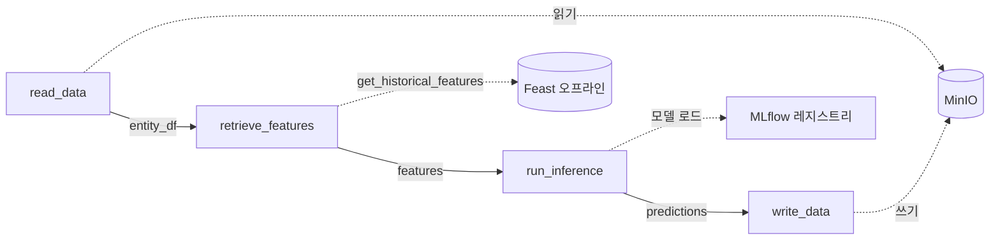

# CH5. ML 파이프라인 오케스트레이션: Kubeflow Pipelines

## 핵심 요약

- 4장의 MLflow와 Feast만으로는 학습, 피처 조회, 추론을 이어 붙이는 일에 여전히 **수동 개입**이 필요하다. 5장은 이걸 **Kubeflow Pipelines(KFP)** 로 자동화한다.
- 만드는 것은 **배치 추론 파이프라인**이다. 사용자 ID 목록을 읽고 → Feast에서 피처를 조회하고 → MLflow 모델로 추론하고 → 결과를 MinIO에 쓴다. 단계마다 **컴포넌트(컨테이너 이미지 + `component.yaml`)** 하나씩이다.
- 각 컴포넌트는 **자기 파드**에서 실행돼 깨끗하게 격리되고, 단계 사이의 데이터는 **MinIO(아티팩트 스토어)** 를 거쳐 넘어간다.
- 파이프라인은 컴포넌트를 DAG로 잇는 파이썬 함수이고, **YAML로 컴파일**해 UI나 클라이언트로 제출한다.
- 책 코드를 그대로 돌리면 **모델 종류, 모델 stage, Feast 레지스트리 주소, 베이스 이미지**에서 막힌다. 이 환경에서 맞춘 방법을 5절에 정리했다.
- KFP는 **배치 추론**에 맞는 도구다. 실시간 추론은 다음 장의 BentoML이다.

---

## 들어가며

4장까지는 모델 하나를 실험하고 등록하고, 피처를 등록해 두는 데까지 했다. 하지만 "누가 언제 피처를 조회하고, 어떤 모델로 추론하고, 결과를 어디에 두는가"는 사람이 손으로 이어야 했다. 추론 파이프라인은 대부분 구조가 같다.


날짜나 피처 테이블 이름 같은 **런타임 파라미터**를 받아 **주기적으로 실행**돼야 하는 점까지 KFP가 한 번에 해결한다. 이 장은 소득 분류 예제로 수작업 단계를 재사용 가능한 컴포넌트로 바꾼다.

---

## 1. 파이프라인 구조



| 단계 | 하는 일 | 입력 | 출력 |
|---|---|---|---|
| `read_data` | MinIO에서 사용자 ID 목록(parquet)을 읽는다 | MinIO 접속 정보, 버킷, 파일명 | `data_output`(Dataset) |
| `retrieve_features` | MinIO의 `feature_store.yaml`로 Feast를 초기화하고 과거 피처를 조회 | 엔티티 DF, 피처 목록 | `data_output`(Dataset) |
| `run_inference` | MLflow 레지스트리에서 모델을 불러와 확률 예측 | 피처 DF, 모델 이름·종류·stage | `data_output`(Dataset) |
| `write_data` | 결과 parquet을 MinIO 버킷에 쓴다 | 예측 DF, 버킷, 파일명 | (없음) |

- 중간 산출물은 전부 MinIO에 저장되고 다음 단계가 읽어 간다.
- 모델은 MLflow에서, 피처는 Feast에서 가져온다.

---

## 2. 컴포넌트 만들기

컴포넌트 하나를 만드는 순서는 같다.

1. 할 일을 **파이썬 파일**로 작성한다 (`argparse`로 파라미터를 받는다)
2. **Docker 이미지**로 만든다
3. 입출력과 이미지를 `component.yaml`로 **명세**한다

### 2.1 디렉터리 구조

```text
├── Dockerfile
├── requirements.txt
├── components/
│   ├── read_data/component.yaml
│   ├── retrieve_features/component.yaml
│   ├── run_inference/component.yaml
│   └── write_data/component.yaml
└── src/
    ├── read_data/read_data.py
    ├── retrieve_features/retrieve_features.py
    ├── run_inference/run_inference.py
    └── write_data/write_data.py
```

### 2.2 `component.yaml`의 입출력 규칙

```yaml
name: Read Data From MinIO
inputs:
- {name: minio_host, type: String}
- {name: bucket_name, type: String}
outputs:
- {name: data_output, type: Dataset}
implementation:
  container:
    image: '<docker_id>/read-minio-data:v1'
    command:
    - python3
    - /app/src/read_data/read_data.py
    - --minio_host
    - {inputValue: minio_host}
    - --data_output_path
    - {outputPath: data_output}
```

| 표기 | 의미 |
|---|---|
| `inputValue` | 문자열 같은 **값**을 그대로 인자로 넘긴다 |
| `inputPath` | 앞 단계가 만든 **데이터셋 파일의 경로**를 인자로 넘긴다 |
| `outputPath` | 이 단계가 **결과를 써야 할 경로**를 KFP가 정해 인자로 넘긴다 |
| `Dataset` 타입 | KFP가 파일을 아티팩트로 인식해 단계 사이로 전달한다 |

코드에서는 `Path(output).parent.mkdir(...)`로 디렉터리를 만든 뒤 `df.to_parquet(output_path)`로 쓰면 된다. 다음 단계는 같은 파일을 입력 경로로 받는다.

### 2.3 각 컴포넌트의 핵심

**read_data**: `Minio(endpoint, access_key, secret_key, secure=False)`로 클라이언트를 만들고 `fget_object`로 parquet을 받아 DataFrame으로 읽는다.

**retrieve_features**
- MinIO에서 `feature_store.yaml`을 내려받아 Feast 스토어를 초기화하고, `get_historical_features(entity_df, features)`로 조회한다. 피처 목록은 쉼표로 이은 문자열(`demographic:Sex,demographic:Race,...`)이다.
- 4장의 레지스트리는 데이터 소스가 `localhost:9000`을 가리켜 **파드 안에서는 쓸 수 없다.** 파드의 `localhost`는 파드 자신이기 때문이다. 소스 엔드포인트를 클러스터 서비스 주소(`minio-service.kubeflow.svc.cluster.local:9000`)로 바꾼 **별도 레지스트리**를 `feast apply`로 다시 만들어야 하고, 이 `feast apply`도 **클러스터 안에서(Job으로)** 실행해야 한다.

**run_inference**
- MLflow 클라이언트로 `current_stage == model_stage`인 모델 버전을 찾고, 그 run의 `column_list.pkl`을 받는다.
- 입력을 `get_dummies(drop_first=True)` 후 `reindex(columns=col_list, fill_value=0)`로 학습 때의 컬럼에 맞춘다.
- `model_type`(sklearn, xgboost, tensorflow)에 맞는 MLflow 메서드로 모델을 로드하고, `predict_proba`의 두 번째 열을 `Predicted_Income_Class`로 추가해 저장한다.

**write_data**: 입력 parquet을 읽어 `fput_object`로 지정 버킷에 올린다. **버킷을 만들어 주지 않으므로** 미리 만들어 둬야 한다.

### 2.4 Dockerfile

```dockerfile
FROM python:3.10-slim-bookworm
WORKDIR /app
RUN apt-get update && apt-get install --no-install-recommends -y build-essential \
    && apt-get clean && rm -rf /tmp/* /var/tmp/*
COPY requirements.txt /app/requirements.txt
RUN pip3 install --upgrade pip && pip3 install --no-cache-dir -r requirements.txt
ENV PYTHONPATH "/app"
COPY . /app
```

- 저장소 전체를 `COPY . /app`으로 복사하고 Makefile이 **같은 Dockerfile로 이름만 다르게 4번** 빌드하므로, 네 이미지는 내용이 같다. 한 번 빌드해 태그 4개를 붙여도 된다.
- 책의 `python:3.10-slim-buster`는 **buster가 EOL이라 `apt-get update`가 실패**한다. 베이스를 `bookworm`으로 바꿨다.

### 2.5 컴포넌트 설계 원칙

| 원칙 | 내용 |
|---|---|
| 모듈성 | 컴포넌트 하나는 기능 하나(단일 책임). 추론과 쓰기를 분리한 이유 |
| 입출력 명시 | `component.yaml`에 필요한 데이터와 산출물을 구체적으로 적는다 |
| 파라미터화 | `mlflow_host`, `bucket_name`, `minio_host`를 하드코딩하지 않고 파라미터로 받아 환경이 달라도 재사용 |
| 문서화 | 기능, 입출력, 사용법을 적어 다른 팀원이 쓸 수 있게 한다 |

효과는 **재사용**(여러 파이프라인에서), **협업**(팀원이 컴포넌트를 나눠 맡음), **테스트**(컴포넌트별로 따로 검증)다.

---

## 3. 파이프라인 정의와 컴파일

```python
import kfp
from kfp import dsl, compiler

fetch_data_op = kfp.components.load_component_from_file("components/read_data/component.yaml")
retrieve_features_op = kfp.components.load_component_from_file("components/retrieve_features/component.yaml")
run_inference_op = kfp.components.load_component_from_file("components/run_inference/component.yaml")
write_data_op = kfp.components.load_component_from_file("components/write_data/component.yaml")

@dsl.pipeline(name="income-classifier-pipeline", description="...")
def income_classifier_pipeline(minio_host: str, access_key: str, secret_key: str,
                               entity_df_bucket: str, entity_df_filename: str,
                               feature_store_bucket_name: str, feature_store_config_file_name: str,
                               feature_list: str, model_name: str, model_type: str,
                               model_stage: str, mlflow_host: str,
                               output_bucket: str, output_file_name: str):
    fetch = fetch_data_op(minio_host=minio_host, ..., bucket_name=entity_df_bucket, file_name=entity_df_filename)
    feats = retrieve_features_op(..., entity_df=fetch.outputs["data_output"], feature_list=feature_list)
    infer = run_inference_op(..., input_data=feats.outputs["data_output"])
    write_data_op(..., input_data=infer.outputs["data_output"])

compiler.Compiler().compile(income_classifier_pipeline, "income_classifier_pipeline.yaml")
```

- 파이프라인은 **방향이 있고 순환이 없는 그래프(DAG)** 다. 각 태스크는 의존하는 태스크가 끝나야 실행된다.
- `task.outputs["data_output"]`를 다음 태스크의 입력으로 넘기면 **그 연결이 곧 의존 관계**가 된다.
- 파이프라인 함수의 인자(14개)가 **실행 시 바꿀 수 있는 파이프라인 파라미터**다. 기본값도 줄 수 있다.
- 컴파일 결과 YAML을 UI에 업로드하거나 클라이언트로 제출한다.

---

## 4. 실행

### 4.1 UI 순서

1. Kubeflow 로그인 → **Pipelines** → **Upload pipeline** (이름, 설명, YAML 경로 입력 후 Create)
2. **Experiment** 생성: 실행들을 묶어 추적하고 비교하는 단위. UI 실행 폼에서 **필수**다
3. **Create Run**: 실험을 고르고 파이프라인 파라미터를 입력한 뒤 Start
4. Runs에서 그래프와 노드별 **Logs** 탭으로 진행을 확인

실험은 **관리 단위**이고 실행(run)은 파이프라인이 **실제로 돈 인스턴스**다.

### 4.2 이 환경의 파라미터 예

| 파라미터 | 값 |
|---|---|
| `minio_host` | `minio-service.kubeflow:9000` (클러스터 내부 주소) |
| `access_key` / `secret_key` | MinIO 키 (Secret에서 확인) |
| `entity_df_bucket` / `entity_df_filename` | `inference-datasets` / `entity_df.parquet` |
| `feature_store_bucket_name` / `..._config_file_name` | `feature-registry` / `feature_store.yaml` |
| `feature_list` | 8개 피처 전부 (`demographic:Sex,demographic:Race,...,occupation:Occupation`) |
| `model_name` / `model_type` / `model_stage` | `random-forest-classifier` / `sklearn` / `Production` |
| `mlflow_host` | `http://<노드 IP>:5000` (`localhost` 불가) |
| `output_bucket` / `output_file_name` | `inference-datasets` / `inference_result.parquet` |

- `entity_df.parquet`은 4장의 사용자 ID·`event_timestamp` 목록(30,162행)이다.
- 기존 결과를 덮어쓰지 않으려면 `output_file_name`을 바꿔 쓴다(예: `inference_result_ui.parquet`).
- **MinIO 키가 파이프라인 파라미터라서 실행 이력에 평문으로 남는다.** 운영이라면 Secret 연동으로 바꿔야 한다.

---

## 5. 책과 다르게 맞춘 곳

### 5.1 모델: sklearn만 된다

- `run_inference.py`는 `model.predict_proba`를 쓴다. `mlflow.xgboost.load_model`은 `xgb.train`으로 만든 **Booster**를 돌려주는데 Booster에는 `predict_proba`가 없다. 4장에서 AUC 1등(XGBoost)이 아닌데도 책이 **랜덤 포레스트**를 등록한 이유로 보인다.
- 4장의 `shivering-tern-287`(test AUC 0.8571)이 RandomForest가 맞았고, 이걸 `random-forest-classifier`로 등록했다.

### 5.2 모델 stage가 필요하다

- 코드가 별칭(alias)이 아니라 **stage 이름**(`current_stage == model_stage`)으로 찾는다. 그래서 등록한 버전의 stage를 `Production`으로 바꿔야 한다.
- MLflow 3.0에도 `transition_model_version_stage`가 있지만 **deprecated**다.
- `column_list.pkl`을 `model.run_id`로 받으므로 등록한 버전에 `run_id`가 채워져 있어야 한다.

```python
mv = mlflow.register_model(f"models:/{model_id}", "random-forest-classifier")
MlflowClient().transition_model_version_stage(
    "random-forest-classifier", mv.version, stage="Production", archive_existing_versions=True)
```

### 5.3 Feast 레지스트리는 클러스터 안에서 만든다

- 호스트에서 `feast apply`로 클러스터 내부 주소를 저장하는 방법은 **안 된다.** `feast apply`가 데이터 소스에 접근해 `HeadObject`를 호출하다가 `Couldn't resolve host name`으로 실패한다. 호스트는 `*.svc.cluster.local`을 해석하지 못한다.
- 선택지는 셋이다. 이 환경에서는 2번을 썼다.

| 방법 | 평가 |
|---|---|
| 1. `scripts/feast/Dockerfile`로 Job 이미지 직접 빌드 | 책의 방식. 공개 이미지(`feast-job`)가 없고 buster 문제도 있다 |
| 2. **Job + ConfigMap + 공식 python 이미지** | 이미지를 빌드하지 않고 `entity.py`, `features.py`, `feature_store.yaml`을 ConfigMap으로 마운트, Job이 `pip install` 후 `feast apply`. 파드가 pip를 받을 수 있어야 한다 |
| 3. 호스트 `/etc/hosts`에 서비스 이름 매핑 | 서버 설정을 건드리는 우회라 권하지 않는다 |

- 5장용 `features.py`는 엔드포인트를 클러스터 주소로, 레지스트리를 `s3://feature-registry/registry.db`로 따로 둔다(4장의 `registry_local.db`와 별개).
- `feature_store.yaml`은 MinIO(`feature-registry`)에 올려 컴포넌트가 내려받게 한다. **Redis 암호를 넣으면 버킷에 평문으로 저장**되므로 암호 없는 사본을 쓴다. 파이프라인은 과거 조회만 하므로 온라인 스토어에는 접속하지 않는다.

### 5.4 컨테이너 이미지

- `:latest` 태그는 쿠버네티스가 **항상 pull을 시도**한다. 노드에 `ctr images import`로 넣어 봐야 소용없으므로 `:v1` 같은 **고정 태그**로 레지스트리(Docker Hub 등)에 push한다.
- 멀티 아키텍처로 빌드해 두면 amd64/arm64 노드 모두에서 뜬다.

```bash
docker buildx build --builder multi --platform linux/amd64,linux/arm64 \
  -t <docker_id>/read-minio-data:v1 -t <docker_id>/retrieve-feast-features:v1 \
  -t <docker_id>/run-inference:v1  -t <docker_id>/write-minio-data:v1 --push .
```

- 에뮬레이션이 없는 서버에서 arm64를 빌드하려면 `tonistiigi/binfmt --install arm64`가 필요하다(privileged 컨테이너, **재부팅하면 사라진다**).
- 컴파일 전에 `component.yaml`의 이미지 이름을 내 레지스트리 것으로 바꾼다.

### 5.5 KFP 버전

- 저장소의 YAML은 `kfp==2.9.0`으로 컴파일됐지만 서버 백엔드는 2.4.0이다. **백엔드 버전에 맞춰 `kfp==2.4.0`으로 다시 컴파일**했다. 챕터 전용 venv를 따로 만들어 다른 장 의존성과 섞이지 않게 한다.

### 5.6 추론 코드의 `drop_first` 문제

- `get_dummies(drop_first=True)`가 **그 배치에서** 알파벳 첫 값을 뺀다. 학습 때 뺀 값과 다르면 `reindex`가 빠진 컬럼을 0으로 채워 **조용히 틀린 예측**이 나올 수 있다.
- 이번처럼 전체 30,162행을 넣으면 모든 범주가 있어 학습 때와 같게 동작한다. **행 수가 적은 배치**에서는 위험하다. 학습 때의 더미 컬럼으로 맞추는 방식으로 고치는 것이 안전하다.

---

## 6. 결과 검증

`read_data` → `retrieve_features` → `run_inference` → `write_data` 네 태스크가 모두 Succeeded였고 출력은 `inference-datasets/inference_result.parquet`이다.

| 항목 | 결과 |
|---|---|
| 크기 | 30,162행 × 91컬럼(90개 더미 + `Predicted_Income_Class`) |
| 결측 | NaN 없음 |
| 고소득(≥0.5) 예측 비율 | 22.1% (데이터의 실제 `>50K` 비율 약 25%와 비슷한 수준) |
| 재현 검증 | 같은 모델(`models:/random-forest-classifier/Production`)을 직접 로드해 계산한 값과 **최대 차이 0.0** |

- 컴포넌트는 파이프라인에 넣기 전에 **서버에서 `src/*.py`를 하나씩 실행해** 데이터 경로, Feast 설정, 추론 로직을 먼저 검증하면 디버깅이 빠르다(이미지와 쿠버네티스 없이도 가능).
- 소요 시간은 이미지 pull 여부에 따라 다르고 약 2~3분이었다.

---

## 7. 막혔던 지점 정리

| 증상 | 원인 | 대응 |
|---|---|---|
| 이미지 빌드 중 `apt-get update` 실패 | `python:3.10-slim-buster` EOL | 베이스를 `bookworm`으로 변경 |
| `feast apply`가 `Couldn't resolve host name` | 호스트가 `*.svc.cluster.local` 해석 불가 | 클러스터 안에서 Job으로 실행 |
| 파드가 Init에서 10분 넘게 멈춤 | 사용자 네임스페이스에 `mlpipeline-minio-artifact` Secret이 없음 | 아래 참고 |
| `No model found in stage Production` | 모델 이름·stage 오타(대소문자 구분) 또는 stage 미전환 | 이름 확인, stage 전환 |
| MLflow 접속 실패 | `mlflow_host`를 `localhost`로 줌 | 파드 안에서는 자기 자신이므로 노드 IP 사용 |
| 컴파일한 YAML이 백엔드와 안 맞을 수 있음 | SDK 2.9.0 ↔ 백엔드 2.4.0 | `kfp==2.4.0`으로 재컴파일 |
| HTTP 접속에서 로그인 후 403·쿠키 오류 | Secure 쿠키 문제로 추정 | HTTPS 또는 접속 경로 확인 |
| `exec format error` | 노드 아키텍처와 이미지 불일치 | 멀티 아키텍처 이미지 |

**네임스페이스 Secret 문제.** metacontroller(v4.11.21)가 KFP 프로필 컨트롤러를 처리하지 못해 필요한 리소스가 만들어지지 않았다. 로그에는 `CustomResourceDefinition "namespaces." not found`가 반복됐다. `/sync` 웹훅에 Namespace를 직접 보내고 돌려받은 리소스를 `kubectl apply`하는 우회로 해결했는데, **근본 해결이 아니라서 새 사용자 네임스페이스를 만들면 같은 문제가 반복된다.**

---

## 8. 참고: KFP standalone으로 가볍게 시작하기

Kubeflow 전체(대시보드, 노트북, KServe, 인증 등)는 무겁다. 파이프라인 기능만 쓰려면 **KFP standalone**으로 설치할 수 있다.

```bash
export PIPELINE_VERSION=2.17.3
kubectl apply -k "github.com/kubeflow/pipelines/manifests/kustomize/cluster-scoped-resources?ref=$PIPELINE_VERSION"
kubectl wait --for condition=established --timeout=60s crd/applications.app.k8s.io
kubectl apply -k "github.com/kubeflow/pipelines/manifests/kustomize/env/platform-agnostic?ref=$PIPELINE_VERSION"
kubectl -n kubeflow patch svc ml-pipeline-ui --type merge -p \
  '{"spec":{"type":"NodePort","ports":[{"port":80,"targetPort":3000,"nodePort":30008}]}}'
```

- **CRD를 먼저** 설치하고 established를 확인한 뒤 본체를 적용한다. 버전은 `ref`로 고정한다.
- 첫 파이프라인은 `@dsl.component` 함수 둘을 `first.output`으로 잇는 방식이다(5장 본문의 `component.yaml` + `load_component_from_file` 방식과 달리 함수 데코레이터로 컴포넌트를 만든다).

```python
@dsl.component(base_image="python:3.11-slim")
def add(a: float, b: float) -> float:
    print(f"{a} + {b} = {a + b}")
    return a + b

@dsl.pipeline(name="week01-hello")
def pipeline(x: float = 1.0, y: float = 2.0):
    first = add(a=x, b=y)
    add(a=first.output, b=10.0)
```

- UI 업로드 대신 `kfp.Client(host=...).create_run_from_pipeline_package(...)`로 바로 실행할 수 있다. `x=3, y=4`로 실행하면 첫 단계가 `7`을, 둘째 단계가 `7 + 10 = 17`을 계산하고, 로그로 **단계 사이 값 전달**을 확인할 수 있다.
- 실행 후 파드는 `system-dag-driver`(전체 흐름), `system-container-driver`(단계 준비), `system-container-impl`(코드 실행)로 나뉘어 뜬다. 단계마다 파드가 따로 뜨므로 단계가 많아지면 파드 수와 이미지 pull 비용도 는다.
- Apple Silicon에서는 일부 KFP 구성 요소 이미지가 amd64 전용일 수 있다. `exec format error`가 나면 Docker Desktop의 x86 에뮬레이션(Rosetta) 설정부터 확인한다.

---

## 정리하며

- KFP의 핵심은 **컴포넌트(이미지 + 명세) → 파이프라인(DAG) → 컴파일 → 제출**이다. 컴파일 결과가 파일이라 코드와 함께 버전 관리하고 CI에서 제출할 수 있다.
- 단계 사이의 데이터는 파일(아티팩트)로 넘어가므로 **입출력 경로와 타입(`inputPath`/`outputPath`/`Dataset`)을 명확히** 정해야 한다.
- 책 코드는 **sklearn 모델, `Production` stage, 클러스터 내부 주소 레지스트리**를 전제로 한다. 4장의 환경을 그대로 가져오면 어긋나는 곳이 많다.
- 추론 로직에는 `drop_first` 같은 **조용히 틀리는 버그**가 숨어 있다. 결과 파일의 크기, 결측, 분포를 직접 로드한 모델의 값과 대조해 보는 검증이 필요하다.
- DevOps 입장에서 챙길 곳은 **이미지 태그 고정과 레지스트리, 아키텍처 호환성, 파이프라인 파라미터로 노출되는 자격증명, 컨트롤러 버전 호환성(metacontroller), SDK와 백엔드 버전 일치**다.
- KFP는 배치 추론에 알맞다. 실시간 추론과 프로덕션 배포는 다음 장의 **BentoML**에서 다룬다.
