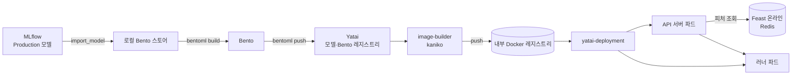

# CH6. ML 모델 프로덕션화: BentoML + Evidently

## 핵심 요약

- 5장이 KFP로 **배치 추론**을 자동화했다면, 6장은 같은 소득 분류기를 **API로 서빙**(BentoML)하고 **데이터 드리프트를 감시**(Evidently)한다. 배포와 모니터링, 수명주기에서 남은 두 과제다.
- **Bento**는 모델 + 서빙 코드 + 의존성을 묶은 **파일 아카이브**(컨테이너 아님)다. `bentofile.yaml` 하나로 Dockerfile, 매니페스트, `/metrics` 엔드포인트를 대신 만들어 준다.
- **Yatai**는 Bento를 받아 쿠버네티스에 배포하는 스택이다. Yatai(레지스트리·UI) + **image-builder**(kaniko로 이미지 빌드) + **deployment**(API 서버·러너 파드 배포)로 나뉜다.
- 배포된 서비스는 **API 서버 파드(프런트)** 와 **러너 파드(모델 추론)** 로 갈라지고 각각 따로 스케일한다.
- **Evidently**는 참조(학습) 데이터와 현재 데이터를 통계 검정으로 비교한다. 배치에서는 **KFP 컴포넌트**로, 실시간에서는 BentoML 서비스 안의 **마이크로배치 윈도**로 리포트를 쌓는다.
- 책 코드는 **패키지 버전, `bentoml containerize`, Yatai 차트 오타, kaniko OOM, 주소(localhost vs 클러스터 내부)** 에서 막힌다. 이 환경에서 맞춘 방법을 5절에 정리했다.

---

## 들어가며

3장에서는 FastAPI 앱 하나를 배포하려고 이미지 빌드, 매니페스트, 모니터링 코드, CI/CD를 전부 손으로 만들었다. 데이터 과학자 모두가 이걸 할 수는 없다. BentoML은 이 과정을 **"Bento 빌드 → Yatai에 push"** 두 단계로 줄인다.

배포한 뒤에는 시간이 지나면서 입력 데이터가 학습 때와 달라져 성능이 떨어질 수 있다(**데이터 드리프트**). Evidently로 이를 탐지해 대시보드에 쌓는다. 예제는 앞 장의 소득 분류기를 그대로 쓴다.

| 항목 | 버전 |
|---|---|
| BentoML | 1.1.10 (Python 3.10) |
| Yatai / image-builder / deployment | 1.1.13 (마지막 릴리스, 2023-10) |
| Evidently | 0.5.0 |
| MLflow 클라이언트 | 3.0.0 (서버에 맞춤, 책은 2.7.0) |
| 실습 코드 | https://github.com/practical-mlops/chapter-6 |

---

## 1. 전체 구조



| 구성 요소 | 역할 |
|---|---|
| **MLflow** | 실험 기록 + "어떤 버전이 승인됐나(stage)"의 기준 |
| **Bento** | 승인된 버전을 코드와 함께 고정한 배포 단위 (tar, 컨테이너 X) |
| **Yatai** | 모델·Bento를 오브젝트 스토리지에 저장하는 레지스트리 + 대시보드 |
| **yatai-image-builder** | Bento를 컨테이너 이미지로 빌드 (kaniko) |
| **yatai-deployment** | 이미지를 API 서버·러너로 배포, Swagger 노출 |

| CRD | 하는 일 |
|---|---|
| `BentoRequest` | 빌드할 Bento 태그와 빌더 리소스를 지정 → 빌드 후 `Bento` 생성 |
| `Bento` | 빌드된 이미지 위치와 러너 정보 |
| `BentoDeployment` | Bento를 참조해 API 서버·러너의 리소스, 오토스케일링, 인그레스를 정의 |

> BentoML은 오픈소스 프레임워크라 인프라(Yatai 등)를 직접 운영한다. **BentoCloud**는 같은 Bento를 받아 빌드·배포·스케일링을 대신 해 주는 관리형 서비스다. 대체 관계가 아니라 같은 Bento를 다르게 운영하는 관계이고, 6장은 BentoML + Yatai만 쓴다.

---

## 2. Bento 만들기

### 2.1 순서

1. **모델 등록**: MLflow 모델을 로컬 Bento 스토어로 가져온다.
2. **서비스·러너 정의** (`service.py`): API 엔드포인트와 추론 로직.
3. **`bentofile.yaml`** 작성: 포함 파일, 의존성, 환경 변수.
4. **빌드 → push**.

### 2.2 모델 등록

`bentoml.mlflow.import_model`에 모델 이름과 MLflow URI(`models:/<이름>/<stage>`)를 준다. MLflow·MinIO 포트포워딩이 필요하다.

```python
mlflow.set_tracking_uri("http://localhost:5000")
os.environ["AWS_ENDPOINT_URL"] = "http://localhost:9000"   # + MinIO 키
bentoml.mlflow.import_model(
    "random-forest-classifier",
    model_uri="models:/random-forest-classifier/Production",
)
```

```bash
$ bentoml models list
Tag                                        Module          Size
random-forest-classifier:wbpagnwu56ztkr6q  bentoml.mlflow  37.02 MiB
```

`Module`이 모델 출처(MLflow)를 나타낸다.

### 2.3 서비스와 러너

- **러너(runner)**: 독립된 파이썬 워커에서 돌고 **따로 스케일되는 연산 단위**. 여기서는 모델 추론을 맡는다. 러너를 여러 개 두면 모델 여러 개를 함께 돌릴 수 있다(모델 비교 등).
- **서비스**: API를 정의하고 러너를 호출한다.

```python
income_clf_runner = bentoml.mlflow.get("random-forest-classifier:latest").to_runner()
svc = bentoml.Service("income_classifier_service", runners=[income_clf_runner])

@svc.on_startup
async def initialise(context: bentoml.Context):
    config = dotenv_values(ENV_FILE_NAME)
    # 1) MLflow에서 Production 버전의 run_id를 찾아 column_list.pkl 다운로드
    # 2) MinIO·Redis 정보로 Feast 피처 스토어 초기화
    context.state["store"] = feature_store.init_feature_store()
    context.state["col_list"] = col_list
    context.state["feature_list"] = ["demographic:Sex", ..., "occupation:Occupation"]

@svc.api(input=JSON(pydantic_model=IncomeClassifierUsers), output=JSON(), route="/predict")
def predict(inputs, ctx):
    feature_df = ctx.state["store"].get_online_features(
        features=ctx.state["feature_list"], entity_rows=[inputs.dict()]).to_df()
    input_df = InputMapper(feature_df.drop(columns=["user_id"]), ctx.state["col_list"]).generate_pandas_dataframe()
    pred = income_clf_runner.predict.run(input_df)[0]
    return {"income_category": OutputMapper(pred).map_prediction(), "user_id": inputs.user_id}
```

- 시작 시 한 번 하는 일(피처 스토어, 컬럼 목록)은 `@svc.on_startup`에서 `context.state`에 넣어 재사용한다.
- 요청 흐름: `user_id` → Feast 온라인 스토어(Redis)에서 피처 조회 → 더미 컬럼 매핑 → 러너 추론 → `0 = <=50K`, `1 = >50K` 라벨로 변환.

### 2.4 `bentofile.yaml`

```yaml
service: "service:svc"           # 파일명:서비스 객체명
labels:
  owner: ml-engineering-team
include: ["service.py", "production.env", "src/*.py", "requirements.txt", "*.env"]
python:
  requirements_txt: requirements.txt
docker:
  env:
    - ENV_NAME=local              # 어떤 .env를 읽을지
    - AWS_ACCESS_KEY_ID=...       # Feast가 MinIO 접근에 사용
    - AWS_SECRET_ACCESS_KEY=...
```

Dockerfile과 비슷하지만 훨씬 짧다. **MinIO 키가 이미지 환경 변수로 들어간다**는 점은 운영이라면 바꿔야 한다.

### 2.5 빌드와 로컬 실행

```bash
bentoml build -f bento/bentofile.yaml
# Successfully built Bento(tag="income_classifier_service:uikaqdwva2bujj2r")

bentoml list
# Tag                                         Size       Model Size
# income_classifier_service:uikaqdwva2bujj2r  22.09 KiB  37.02 MiB
```

`Size`는 애플리케이션, `Model Size`는 모델 크기다. 책은 `bentoml containerize` → `docker run -p 3000:3000`으로 띄운다(이 환경에서는 5.2 참고).

```bash
curl -s -X POST localhost:3000/predict -H "Content-Type: application/json" \
  -d '{"user_id":"9f2ac416-06e1-44a0-87bd-d4787c85bf66"}'
# {"income_category": "<=50K", "user_id": "9f2ac416-..."}
```

---

## 3. Yatai로 배포하기

### 3.1 설치 구성

| 컴포넌트 | 네임스페이스 | 비고 |
|---|---|---|
| Yatai 1.1.13 | `yatai-system` | 4·5장의 PostgreSQL(`yatai` DB·롤)과 MinIO(`yatai` 버킷) 사용, ClusterIP + port-forward |
| cert-manager v1.16.2 | `cert-manager` | image-builder·deployment 웹훅 인증서 |
| 내부 Docker 레지스트리 + 노드 프록시 | `yatai-image-builder` | `registry:2` + socat DaemonSet(hostPort 5000) |
| yatai-image-builder 1.1.13 (+crds) | `yatai-image-builder` | 빌드 엔진 kaniko |
| yatai-deployment 1.1.13 (+crds) | `yatai-deployment` | `bentoDeploymentNamespaces: [yatai]` |

1.1.x에서는 배포에 필요한 `Bento` 리소스를 image-builder가 만들기 때문에 **두 컴포넌트를 모두** 설치하고 버전을 Yatai와 맞춘다. 설치 직후 두 컴포넌트가 Yatai `default` 클러스터에 스스로 등록되고(`yatai_component` 테이블 2행), 화면을 새로고침하면 "배포" 메뉴가 열린다.

**Yatai values의 핵심** (자격증명은 전부 기존 Secret 참조):

```yaml
service: {type: ClusterIP, port: 80}
postgresql:
  host: postgres-release-postgresql.postgres.svc.cluster.local
  user: yatai
  database: yatai
  passwordExistingSecretName: yatai-postgresql
  passwordExistingSecretKey: password
s3:
  endpoint: minio-service.kubeflow.svc.cluster.local:9000
  bucketName: yatai
  secure: false
  accessKeyExistingSecretName: yatai-s3
  accessKeyExistingSecretKey: access_key   # 차트 기본값이 오타(aceess…)라 반드시 직접 지정
  secretKeyExistingSecretName: yatai-s3
  secretKeyExistingSecretKey: secret_key
```

**레지스트리 주소를 둘로 나눈 이유.** 노드의 containerd는 클러스터 DNS(`*.svc.cluster.local`)를 풀 수 없다. 그래서 각 노드에 socat 프록시를 hostPort 5000으로 띄워 `127.0.0.1:5000`을 레지스트리 Service로 넘긴다. **pull은 `127.0.0.1:5000`**, **kaniko push는 클러스터 내부 이름**으로 한다.

```yaml
# image-builder-values.yaml
dockerRegistry:
  server: 127.0.0.1:5000
  inClusterServer: docker-registry.yatai-image-builder.svc.cluster.local:5000
  secure: false
  bentoRepositoryName: yatai-bentos
bentoImageBuildEngine: kaniko
```

```yaml
# deployment-values.yaml
layers:
  network:
    ingressClass: nginx
    domainSuffix: yatai.local
    automaticDomainSuffixGeneration: false   # 기본값은 ingress-nginx 외부 IP로 *.sslip.io 생성
bentoDeploymentNamespaces: ["yatai"]
```

kind에는 외부 IP도 ingress-nginx도 없으므로 도메인을 고정값으로 준다. Ingress 객체는 생기지만 컨트롤러가 없어 쓰이지 않고, 접속은 port-forward로 한다.

### 3.2 push

```bash
# 초기 관리자 설정 토큰 → /setup?token=... 에서 계정 생성 → API 토큰 발급
kubectl -n yatai-system get secret yatai-env -o jsonpath='{.data.YATAI_INITIALIZATION_TOKEN}' | base64 -d

bentoml yatai login --api-token <API 토큰> --endpoint http://localhost:8081
bentoml push income_classifier_service:<태그>
# Successfully pushed model "random-forest-classifier:..."
# Successfully pushed bento "income_classifier_service:..."
```

API 토큰 권한은 범위별로 고른다: **API**(전체 읽기/쓰기), **조직 읽기/쓰기**, **클러스터 읽기/쓰기**. BentoML 1.1.10은 기본 proxy 방식으로 Yatai를 거쳐 업로드한다.

### 3.3 UI 배포

Models·Bentos 탭에서 push 결과를 확인한 뒤 **Deployments → Create**.

| 항목 | 값 |
|---|---|
| Cluster / Namespace | `default` / `yatai` |
| Deployment Name | `income-classifier-service` |
| Bento | `income_classifier_service` : `<태그>` |
| Replicas | 1 |
| CPU req / limit | 500m / 1000m |
| Memory req / limit | 512Mi / 4Gi |

Submit하면 Yatai가 `yatai-bento-image-builder-*` 파드(kaniko)로 이미지를 빌드해 내부 레지스트리에 올리고, 이어서 배포한다. **이 빌더 파드가 OOM으로 죽는다**(5.4 참고).

### 3.4 배포 결과

```bash
$ kubectl get bentorequest,bentodeployment,bento -n yatai
# BentoRequest  IMAGE-EXISTS=True  BENTO-AVAILABLE=True  IMAGE-BUILDER-POD-PHASE=Succeeded
# BentoDeployment  AVAILABLE=True
# Bento  IMAGE=127.0.0.1:5000/yatai-bentos:yatai.income_classifier_service.<태그>

$ kubectl get pod -n yatai
income-classifier-service-xxx            3/3  Running    # API 서버
income-classifier-service-runner-0-xxx   2/2  Running    # 러너
yatai-bento-image-builder-xxx            0/1  Completed  # 빌더
```

| 파드 | 컨테이너 |
|---|---|
| API 서버 | `main`(Bento 이미지) + `metrics-transformer` + `proxy`(envoy, `bentoml-proxy`) |
| 러너 | `main`(같은 Bento 이미지) + `metrics-transformer` |

- API 서버와 러너는 **같은 이미지**를 다른 역할로 띄운다. API 서버는 요청을 받고, 러너는 모델을 들고 추론한다. 둘에 **각각 HPA**(CPU 80%, 1~2개)가 붙는다.
- `/metrics` 엔드포인트가 기본으로 열려 RPS, 지연 시간 등을 Prometheus로 긁을 수 있다.
- 접속: `kubectl -n yatai port-forward svc/income-classifier-service 3002:3000` → 루트(`/`)에서 Swagger UI, `POST /predict` 테스트.

**Dockerfile, 매니페스트, 메트릭 코드를 하나도 쓰지 않고** `bentofile.yaml`만으로 여기까지 왔다는 게 BentoML의 요점이다.

---

## 4. Evidently로 데이터 드리프트 감시

### 4.1 드리프트 유형

| 유형 | 무엇이 바뀌나 | 예 |
|---|---|---|
| 레이블 드리프트 | 목표 변수(정답) 자체 | "불량"의 기준이 바뀜 |
| 사전 확률 이동 | 클래스 비율 | 사기/정상 비율 변화 |
| 공변량 이동 | 입력 피처 분포 | 고객 인구통계·위치 변화 |
| 급격한 드리프트 | 갑작스러운 외부 요인 | 팬데믹, 시장 사건 |

### 4.2 통계 검정

| 검정 | 대상 | 판정 |
|---|---|---|
| KS 검정 | 수치형 (CDF 비교) | p-value < 임곗값(예 0.05)이면 드리프트 |
| 카이제곱 검정 | 범주형 | p-value < 임곗값이면 드리프트 |
| 바서슈타인 거리 (Earth Mover's) | 수치형 | 거리 > 임곗값(기본 0.1)이면 드리프트, 0~∞ |

Evidently가 데이터에 맞는 검정을 자동으로 고르고, 직접 지정하거나 만들 수도 있다.

### 4.3 Report, Metric, Preset

- **Report**: 검사 항목 바구니. 참조(reference) 데이터와 현재(current) 데이터 두 개만 있으면 된다.
- **Metric**: 검사 항목 하나. 단일형(`DatasetMissingValuesMetric`, 결측 비율)과 묶음형(`DatasetSummaryMetric`, 기술 통계)이 있고, 데이터셋 수준과 컬럼 수준이 있다.
- **Preset**: 미리 묶은 패키지. `DataDriftPreset`, `DataQualityPreset`, `RegressionPreset`.

```python
report = Report(metrics=[DataDriftPreset()])
report.run(reference_data=reference_data, current_data=current_data)
report.save_html("drift_report.html")
```

**두 단계 판정.** 먼저 컬럼마다 드리프트인지 판정(예: 바서슈타인 0.1)하고, 드리프트 컬럼 비율이 **데이터셋 임곗값(0.5)** 을 넘으면 데이터셋 전체를 드리프트로 본다. 8개 중 6개(0.75)면 "Dataset Drift is detected". 컬럼 임곗값 0.1과 데이터셋 임곗값 0.5는 다른 값이다.

### 4.4 UI, 워크스페이스, 대시보드

```text
workspace/              # 모든 스냅샷을 보관하는 디렉터리
├── project_1/
│   ├── snapshot_1.json
│   └── snapshot_2.json
└── project_2/ ...
```

- 리포트는 한 시점의 스냅샷이다. 시간에 따른 변화를 보려면 스냅샷을 쌓아 **대시보드**로 본다. `evidently ui`가 8000 포트로 뜬다.
- `RemoteWorkspace("http://...:8000")`로 UI에 붙어 `income-classifier` 프로젝트를 만들고 패널을 추가한다. **`project.save()`를 해야 UI에 반영된다.**

| 패널 | 용도 | 핵심 설정 |
|---|---|---|
| `DashboardPanelCounter` (값 없음) | 제목 배너 | `agg=CounterAgg.NONE` |
| `DashboardPanelCounter` | Share of Drifted Features | `metric_id="DatasetDriftMetric"`, `field_path="share_of_drifted_columns"`, `agg=LAST` |
| `DashboardPanelCounter` | Model Calls | `DatasetMissingValuesMetric.current.number_of_rows`, `agg=SUM` |
| `DashboardPanelPlot` (LINE) | Dataset Quality | 드리프트 비율 + 결측 비율 |
| `DashboardPanelPlot` (BAR) ×8 | 컬럼별 Drift Score | `ColumnDriftMetric`, `metric_args={"column_name.name": "<컬럼>"}` |

- `PanelValue`는 "어느 메트릭(`metric_id`)의 어느 필드(`field_path`)"를 꺼낼지 가리키는 주소다. **리포트에 그 메트릭이 들어 있어야** 값이 나온다.
- `agg=LAST`는 스냅샷 여러 개 중 가장 최근 값, `size`는 1이 절반 너비, 2가 전체 너비.

이 환경에서는 Evidently UI를 직접 이미지(`python:3.10-slim-bookworm` + `evidently==0.5.0`)로 빌드해 `kind load` 후 `evidently` 네임스페이스에 Deployment + PVC(워크스페이스) + ClusterIP로 띄웠다.

### 4.5 배치: KFP 드리프트 컴포넌트

5장 추론 파이프라인의 **피처 조회와 추론 사이**에 `detect_drift`를 끼운다.

```mermaid
flowchart LR
  F[fetch_data] --> R[retrieve_features]
  R --> D[detect_drift]
  D -. .after .-> I[run_inference]
  R -->|features| I
  I --> W[write_data]
  D -. add_report .-> E[(Evidently UI)]
```

`detect_drift`가 하는 일:

1. MLflow에서 `model_stage`의 버전을 찾아 `run_id`를 얻는다.
2. 그 run의 `dataset_inputs`에서 태그가 `reference_dataset_name`인 데이터셋의 `source.uri`를 찾는다(4장에서 기록한 학습 데이터).
3. MinIO에서 참조 CSV를 받고, 이전 단계의 피처 parquet을 현재 데이터로 읽는다.
4. `DatasetDriftMetric`, `DatasetMissingValuesMetric`, 컬럼 8개 × (`ColumnDriftMetric` + `ColumnSummaryMetric`)로 리포트 실행. **대시보드 패널의 메트릭과 일치해야 한다.**
5. `workspace.add_report(project.id, report)`로 Evidently에 기록.

5장 `run-parameters.json`에 네 개를 더한다.

| 파라미터 | 값 |
|---|---|
| `reference_dataset_name` | `reference_features` |
| `evidently_workspace_url` | `http://evidently-ui.evidently.svc.cluster.local:8000` (파드에서 실행되므로 `localhost` 불가) |
| `evidently_ui_project_name` | `income-classifier` |
| `output_file_name` | `income_predictions_with_drift.parquet` |

**주의: 책은 "드리프트가 탐지되면 파이프라인을 중단한다"고 쓰지만 코드는 그렇지 않다.** `run_inference`는 `.after(detect_drift)`라 순서만 뒤일 뿐이고, 드리프트가 나와도 추론은 진행된다. `detect_drift`가 예외로 실패해야만 멈춘다. 정말 막으려면 드리프트 여부를 출력으로 내고 `dsl.If`(`dsl.Condition`)로 분기해야 한다.

**재실행 시 캐시.** 입력이 같으면 KFP가 이전 결과를 재사용한다. 코드에서 `fetch_data`만 캐시를 껐으므로, 리포트를 새로 쌓으려면 `create_run_from_pipeline_package(..., enable_caching=False)`로 실행한다(이미 등록한 파이프라인이면 `upload_pipeline`은 뺀다).

### 4.6 실시간: BentoML 서비스 안의 마이크로배치

요청 하나로는 분포를 비교할 수 없으므로 **최근 N개(윈도)를 모아** 참조 데이터와 비교한다. 최근 N개만 담는 컨베이어 벨트다.

```python
class MonitoringService:
    def iterate(self, new_rows):
        self.current = pandas.concat([self.current, new_rows], ignore_index=True)
        if len(self.current) > self.window_size:
            self.current = self.current.iloc[-self.window_size:]   # 오래된 행 제거
        if len(self.current) < self.window_size:
            return                                                # 아직 부족
        self.report.run(reference_data=self.reference, current_data=self.current)
        self.workspace.add_report(project_id=self.project_id, report=self.report)
```

- `initialise`에서 MLflow로 참조 데이터셋을 받아 `MonitoringService`를 만들고, `predict`마다 `ctx.state["monitoring_service"].iterate(feature_df)`를 부른다.
- 윈도가 차면 **요청마다** 리포트가 하나씩 생긴다. 프로젝트 ID와 윈도 크기는 `.env`(`EVIDENTLY_PROJECT_ID`, `EVIDENTLY_REPORT_WINDOW_SIZE`)에서 읽는다.
- `bentofile_with_drift.yaml`로 따로 빌드한다(`service_with_drift_detection.py`, `data_drift.py`, `evidently_reports.py` 포함).

**작은 윈도의 거짓 경보.** 윈도 50에서 드리프트 비율이 **0.875**까지 나왔다. 현재 데이터가 학습 데이터에서 온 것이라 드리프트가 없어야 정상인데도 그렇다. 표본이 작으면 우연한 쏠림으로 분포가 달라 보이고, 거리 기반 검정은 작은 표본에서 값이 크게 나오기 쉽다.

- 윈도를 키운다(200, 500 등). 비용·반응 속도와의 균형.
- 컬럼 임곗값이나 데이터셋 임곗값(0.5)을 조정한다.
- 알림은 한 번이 아니라 **연속 몇 회 초과**할 때만 울리게 한다(일반적인 운영 방식).

### 4.7 드리프트를 만났을 때

1. **조사**: 유형과 심각도, 실제로 정확도·공정성에 영향이 있는지.
2. **업스트림 수정**: 데이터 파이프라인 변경이 원인이면 파이프라인과 전처리를 고친다.
3. **재학습**: 성능 영향이 크면 최신 데이터로 다시 학습한다.
4. **피처 선택 재검토**: 피처 중요도가 바뀌었다면 피처를 추가·제거·수정한다.

---

## 5. 책과 다르게 맞춘 곳

### 5.1 패키지 버전

```bash
# MLflow 클라이언트를 서버(3.0.0)에 맞추고 bentoml 주석 해제
sed -i 's/^mlflow==2.7.0/mlflow==3.0.0/' bentoml/requirements_with_drift.txt evidently/kubeflow-pipeline/requirements.txt
sed -i 's/^#bentoml==1.1.10/bentoml==1.1.10/' bentoml/requirements.txt
# litestar/multipart 충돌 + sniffio 누락
printf 'litestar==2.12.1\nsniffio\n' >> bentoml/requirements_with_drift.txt

uv venv .venv --python 3.10 && source .venv/bin/activate
uv pip install -r bentoml/requirements.txt -r bentoml/requirements_with_drift.txt "setuptools<81"
# 기대: bentoml 1.1.10 / mlflow 3.0.0 / evidently 0.5.0 / feast 0.40.1
uv pip list | grep -i multipart   # python-multipart만 보여야 함
```

- **`setuptools<81` 고정**: BentoML 1.1.10이 의존하는 `fs` 패키지가 `pkg_resources`를 import한다. setuptools 81부터 제거될 예정이라 그대로 두면 BentoML이 아예 안 뜬다. 고정해도 deprecated 경고는 계속 찍히는데 **영향은 없다**. 경고만 숨기려면 `PYTHONWARNINGS="ignore:pkg_resources is deprecated:UserWarning"`. 근본 해결은 BentoML 1.2+인데, Yatai 1.1.13 호환 때문에 올리지 않았다.

### 5.2 `bentoml containerize`가 실패한다

이 환경에서 `NotImplementedError`로 실패한다. 같은 내부 함수를 직접 부르는 스크립트로 대신했다. **Bento 디렉터리에서 `docker build`를 직접 돌리면 모델이 빠진 이미지**가 만들어지므로 쓰지 않는다.

```python
# build_bento_image.py
import sys
from bentoml._internal.container import build
bento_tag, image_tag = sys.argv[1], sys.argv[2]
build(bento_tag, backend="docker", tag=(image_tag,))
```

```bash
python -W ignore build_bento_image.py $TAG $TAG   # 3~10분, 이미지 약 2.5GB
```

### 5.3 로컬 컨테이너 실행 주소

포트포워딩이 `127.0.0.1`에만 열려 있어서 `-p 3000:3000` 대신 **호스트 네트워크 + `host.docker.internal` → `127.0.0.1` 매핑**을 썼다.

```bash
docker run -d --name income-clf --network host --add-host host.docker.internal:127.0.0.1 $TAG

# 드리프트 버전은 3001 포트, 워커 1개
docker run -d --name income-clf-drift --network host --add-host host.docker.internal:127.0.0.1 \
  -e BENTOML_PORT=3001 -e BENTOML_CONFIG_OPTIONS="api_server.workers=1" income-classifier-drift:<태그>
```

**`api_server.workers=1`이 중요하다.** 워커가 여러 개면 시작할 때 같은 디렉터리에 동시에 파일을 받아 오류가 나고, 워커마다 윈도를 따로 쌓아 리포트가 생기지 않는다. 실시간 드리프트 윈도를 프로세스 메모리에 두는 설계의 한계다(파드를 여러 개로 늘려도 같은 문제).

같은 이유로 이 Bento의 MLflow·Feast·Redis 주소는 로컬 포워딩 기준이다. 클러스터 파드에서 쓰려면 `production.env`를 클러스터 내부 주소로 바꾸고 다시 빌드해야 한다(`EVIDENTLY_WORKSPACE_URL=http://evidently-ui.evidently.svc.cluster.local:8000` 등). `EVIDENTLY_PROJECT_ID`도 저자의 UUID가 아니라 **직접 만든 프로젝트 ID**로 `.env`, `production.env` 둘 다 바꾼다.

### 5.4 kaniko 빌더 OOM

UI에서 준 리소스는 `BentoDeployment`(API 서버·러너)에만 반영되고, **빌더 파드는 기본값(limit 3Gi)** 으로 떠서 `OOMKilled`가 났다. `BentoRequest`에 빌더 리소스를 직접 패치하면 다시 빌드된다.

```bash
kubectl -n yatai patch bentorequest <이름> --type merge -p \
  '{"spec":{"imageBuilderContainerResources":{"requests":{"cpu":"500m","memory":"2Gi"},"limits":{"cpu":"2","memory":"6Gi"}}}}'
```

### 5.5 KFP 드리프트 컴포넌트 이미지

```bash
sed -i 's/python:3.10-slim-buster/python:3.10-slim-bookworm/' evidently/kubeflow-pipeline/Dockerfile   # buster apt 404
sed -i -E "s#image: 'varunmallya/[a-z-]+:latest'#image: 'book-ch6/drift-components:0.1'#" \
  evidently/kubeflow-pipeline/components/*/component.yaml

docker build -t book-ch6/drift-components:0.1 .
kind load docker-image book-ch6/drift-components:0.1 --name book-env
```

5장처럼 `:latest` 대신 고정 태그를 쓰고, 컴포넌트 5개가 이미지 하나를 공유한다(`grep image:` → ×5).

---

## 6. 막혔던 지점 정리

| 증상 | 원인 | 대응 |
|---|---|---|
| `bentoml containerize` → `NotImplementedError` | 이 환경의 BentoML 1.1.10 문제 | `bentoml._internal.container.build` 직접 호출 |
| `No module named 'pkg_resources'` 위험, deprecated 경고 | `fs` 패키지가 `pkg_resources` 사용 | `setuptools<81` 고정, 경고는 무시 |
| multipart 관련 import 오류 | litestar·multipart 패키지 충돌, sniffio 누락 | `litestar==2.12.1`, `sniffio` 추가 |
| MLflow 클라이언트 오류 | 책 2.7.0 ↔ 서버 3.0.0 | 클라이언트 3.0.0 |
| Yatai S3 접속 실패 | 차트 기본값 키 이름 오타(`aceess…`) | `accessKeyExistingSecretKey` 직접 지정 |
| 노드가 이미지 pull 실패 | containerd가 클러스터 DNS 해석 불가 | socat 프록시 DaemonSet, pull은 `127.0.0.1:5000` |
| 인그레스 도메인 생성 실패 | kind에 외부 IP·ingress-nginx 없음 | `automaticDomainSuffixGeneration: false`, port-forward |
| 빌더 파드 `OOMKilled` | kaniko 기본 limit 3Gi | `BentoRequest`에 빌더 리소스 패치(6Gi) |
| 드리프트 서비스 시작 오류·리포트 없음 | 워커 여러 개가 파일·윈도를 따로 씀 | `api_server.workers=1` |
| 학습 데이터인데 드리프트 0.875 | 윈도 50이 너무 작음 | 윈도 확대, 임곗값 조정 |
| KFP 재실행 시 리포트가 안 쌓임 | 캐시 적중으로 단계 건너뜀 | `enable_caching=False` |
| `detect_drift`에서 Evidently 접속 실패 | `localhost` 사용 | 클러스터 내부 서비스 주소 |

---

## 7. 해 볼 것

- UI 대신 **`BentoRequest`·`BentoDeployment` CRD를 직접 작성**해 배포하기 (GitOps로 관리하려면 이쪽이 맞다)
- 내부 레지스트리 대신 **Docker Hub나 Harbor** 사용
- Yatai 대체 도구 조사: 레지스트리 → **KitOps**(모델·코드를 OCI 아티팩트로), image-builder → **KFP 빌드 단계**, deployment → **KServe**
- Yatai 없이 **MLflow → BentoML → KServe**: Bento 이미지를 `InferenceService`의 사용자 컨테이너(`kserve-container`, 3000 포트)로 그대로 띄우는 방식
- `/metrics`를 **Prometheus로 수집하고 Grafana 대시보드** 만들기

---

## 정리하며

- BentoML은 배포의 기술 장벽을 낮춘다. `bentofile.yaml`만으로 이미지, 매니페스트, `/metrics`가 나오므로 데이터 과학자도 모델을 API로 낼 수 있다. 다만 **밑바탕의 Docker·Kubernetes를 알아야** 커스터마이징하고 문제를 풀 수 있다(이번 장의 OOM, 레지스트리, 주소 문제가 전부 그쪽이었다).
- Yatai 1.1.x는 **2023년 마지막 릴리스**에서 멈춰 있다. 학습용으로는 구조(레지스트리 → 빌드 → 배포 CRD)를 이해하기 좋지만, 운영이라면 KServe 같은 대안이나 BentoCloud를 검토하는 게 현실적이다.
- 드리프트 모니터링을 파이프라인에 넣으면 성능 저하를 **조기에** 알아채 비싼 실수를 막을 수 있다. 배치는 KFP 컴포넌트로, 실시간은 마이크로배치 윈도로 같은 대시보드에 쌓는다.
- 드리프트 숫자는 그대로 믿으면 안 된다. **윈도 크기와 임곗값에 따라 거짓 경보**가 쉽게 나고, 책의 "드리프트 시 중단"도 실제 코드는 순서만 정할 뿐이다.
- DevOps 입장에서 챙길 곳은 **레지스트리 주소 이원화(노드 pull vs 클러스터 push), 빌더 리소스, 차트 기본값 오타, 이미지·파라미터에 박히는 자격증명, 로컬 주소와 클러스터 주소의 분리, 상태를 메모리에 두는 실시간 모니터링의 스케일 한계**다.
