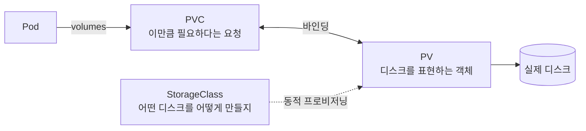

# CH9. 스테이트풀 애플리케이션: 볼륨, PV/PVC, StatefulSet

## 핵심 요약

- 9장은 쿠버네티스에서 **디스크와 상태**를 다루는 방법이다. 순서는 **볼륨 → PV/PVC/StorageClass → StatefulSet → 디스크 복구·마이그레이션 → 대용량 임시 볼륨**이다.
- 볼륨 종류는 목적이 다르다. **emptyDir**은 컨테이너끼리 공유하는 임시 공간, **ConfigMap 볼륨**은 읽기 전용 설정 파일, **클라우드 디스크 직접 마운트**는 수동·비이식이라 권장하지 않는다.
- 영구 저장은 **PVC(요청) → PV(디스크 표현)** 로 추상화한다. PVC는 요청으로 시작해 **바인딩되면 특정 디스크에 대한 클레임**이 된다. 동적 프로비저닝 방식은 **StorageClass**가 정한다.
- **StorageClass 기본값은 대개 `reclaimPolicy: Delete`** 라서 PVC를 지우면 디스크도 사라진다. 귀한 데이터는 **`Retain`** 클래스를 따로 만들어 쓴다.
- Deployment는 모든 복제본이 **같은 PVC**를 쓰는데 ReadWriteOnce 볼륨은 한 파드에만 붙는다. **StatefulSet**은 `volumeClaimTemplates`로 **파드마다 PVC를 만들고**, **고정된 이름(서수)** 과 **순서 보장**을 준다. 서수로 **리더/팔로워 역할**을 나눌 수 있다(Redis 예제).
- `Retain`이면 클러스터 객체를 전부 지워도 **PV/PVC를 손으로 다시 이어서** 데이터를 복구하거나 다른 클러스터로 옮길 수 있다. 핵심은 **`claimRef.uid` 삭제, `bind-completed` 어노테이션 삭제, `storageClassName: ""`** 이다.
- 큰 스크래치 공간이 필요하면 **generic ephemeral volume**을 쓴다. 부팅 디스크와 무관하게 큰 볼륨을 만들고 파드가 사라지면 같이 지워진다.

---

## 들어가며

쿠버네티스는 상태 없는 워크로드만 돌리는 게 아니다. 다만 상태를 다루려면 **디스크를 쿠버네티스 객체로 어떻게 표현하는지**부터 알아야 한다. 노드가 VM을 쿠버네티스에서 표현한 것이듯, 디스크에도 고유한 표현이 있다.



### 실습 환경 (kind)

| 항목 | 내용 |
|---|---|
| 클러스터 | kind `v1.32.5`, 컨트롤 플레인 1 + 워커 3 (`rack=1~3` 라벨) |
| 스토리지 클래스 | `standard`(기본), provisioner `rancher.io/local-path`, `Delete`, `WaitForFirstConsumer` |
| 시각화 | kube-ops-view (NodePort 30000, 컨트롤 플레인에 고정) |

kind의 `local-path`는 PV가 **노드의 `hostPath` 디렉터리**이고 노드 어피니티로 그 노드에 묶인다. 클라우드 블록 디스크의 동작을 흉내 낸 것이라, 같은 개념을 로컬에서 확인하는 용도다.

---

## 1. 볼륨, PV, PVC, StorageClass (9.1)

### 1.1 볼륨 (9.1.1)

볼륨은 **파드의 컨테이너가 접근하는 디렉터리**다. 그 디렉터리가 어떻게 만들어지고 무엇이 받치는지는 **볼륨 유형**이 정한다.

| 유형 | 수명 | 용도 |
|---|---|---|
| `emptyDir` | 노드·파드에 묶인 **임시** | 컨테이너 간 데이터 공유, 디스크 캐시 |
| `configMap` | ConfigMap | **읽기 전용** 설정 파일 마운트 |
| 클라우드 디스크 직접 지정 | 디스크 자체 | 영구 저장(수동, 비권장) |

**emptyDir**

- 노드의 **부팅 디스크** 공간을 쓰는 임시 볼륨이다. **파드 삭제, 다른 노드로 이동, 노드 비정상** 때 데이터가 사라진다.
- 같은 파드 안의 **여러 컨테이너가 마운트를 공유**할 수 있고, **컨테이너 재시작 사이에는 유지**된다. 그래서 재시작해도 남아 있으면 좋은 캐시에 쓴다.
- 이름은 "노드의 처음엔 비어 있는 디렉터리"라는 뜻이다(책은 작명이 아쉽다고 한다).
- 큰 스크래치 공간이 필요하면 emptyDir 대신 4절의 generic ephemeral volume을 쓴다.

```yaml
spec:
  containers:
  - name: timeserver-container
    volumeMounts:
    - {name: cache-volume, mountPath: /app/cache/}
  volumes:
  - name: cache-volume
    emptyDir: {}
```

**ConfigMap 볼륨**

- 키-값뿐 아니라 **파일 전체**(`my.cnf`, `httpd.conf`, `redis.conf`)를 담아 컨테이너에 파일로 보여 준다. **읽기 전용**이다.
- 공식 이미지를 그대로 쓰면서 **설정 파일 하나만 주입**할 때 유용하다. 파일 하나 때문에 이미지를 새로 빌드하지 않아도 된다.

**클라우드 디스크 직접 마운트 (비권장)**

```yaml
spec:
  nodeSelector:
    topology.kubernetes.io/zone: us-west1-a      # 디스크가 있는 존
  containers:
  - name: mariadb-container
    volumeMounts: [{mountPath: /var/lib/mysql, name: mariadb-volume}]
  volumes:
  - name: mariadb-volume
    gcePersistentDisk: {pdName: mariadb-disk, fsType: ext4}
```

- 디스크를 **쿠버네티스 밖에서 먼저 만들어야** 한다(`gcloud compute disks create ...`). 디스크와 파드의 **존이 같아야** 해서 `nodeSelector`로 맞춘다.
- 단점: ① 파드를 만드는 사람에게 디스크 생성 권한이 필요하다 ② 쿠버네티스 설정 밖에 **수동 단계**가 남는다 ③ 볼륨 기술자가 플랫폼 종속이라 **YAML을 옮길 수 없다**.
- 디스크를 못 찾으면 파드가 `ContainerCreating`에서 멈추고 이벤트에 `FailedAttachVolume ... disk not found`가 뜬다. 이 문제는 PV/PVC로 해결한다.

### 1.2 PV와 PVC (9.1.2)

파드는 디스크를 직접 가리키지 않고 **PersistentVolumeClaim**을 참조해 필요한 디스크를 **플랫폼 중립적으로**("2GiB") 요청한다. 디스크 자체는 **PersistentVolume** 객체로 표현한다. 컴퓨트에서 파드가 CPU·메모리를 요청하고 노드가 그것을 제공하는 구조와 같다.

```yaml
# 파드는 PVC만 참조
volumes:
- name: mariadb-volume
  persistentVolumeClaim: {claimName: mariadb-pv-claim}
---
apiVersion: v1
kind: PersistentVolumeClaim
metadata: {name: mariadb-pv-claim}
spec:
  accessModes: [ReadWriteOnce]
  resources: {requests: {storage: 2Gi}}
```

| accessMode | 의미 |
|---|---|
| `ReadWriteOnce` (RWO) | **한 파드**가 읽기/쓰기. 일반 하드디스크처럼 동작하는 **가장 흔한 모드**. 이 장은 전부 RWO |
| `ReadOnlyMany` (ROX) | 여러 파드가 기존 데이터를 읽기 전용으로 공유 |
| `ReadWriteMany` (RWX) | 여러 파드가 동시에 읽기/쓰기(NFS 같은 파일 스토리지). 지원하는 드라이버가 적다 |

**동적 프로비저닝과 바인딩**

- 공급자가 동적 프로비저닝을 지원하면(거의 모든 곳이 지원) PVC가 생길 때 **디스크와 PV가 만들어지고 PVC와 바인딩**된다. 기본 StorageClass가 있어 위 YAML은 거의 어디서나 그대로 동작한다.
- 동적 프로비저닝이 없으면 관리자가 **PV를 미리 손으로 만들어 두고**, 쿠버네티스가 PVC와 맞는 PV를 이어 준다.
- kind 실습에서는 이 한 번의 배포로 **파드 + PVC(Bound) + PV(Delete)** 가 생겼고, `volume.kubernetes.io/selected-node: myk8s-worker3`로 워커3에 묶였다.

**PVC의 변신**

바인딩되면 PVC가 바뀐다. 요청이었던 PVC에 `volumeName`이 채워지고, PV에는 `claimRef`가 채워져 **서로를 가리킨다**. 다른 객체는 이렇게 "일반적인 요청에서 특정 자원에 묶인 상태 객체"로 바뀌는 경우가 드물다.

| | PVC | PV |
|---|---|---|
| 바인딩 전 | `storage: 2Gi` 요청 | (없음, 또는 대기 중) |
| 바인딩 후 | `spec.volumeName: pvc-989e...` | `spec.claimRef: {name: mariadb-pv-claim, namespace: default}`, `status.phase: Bound` |

- 바인딩된 PV/PVC는 디스크가 지워질 때까지 보통 **연결된 상태로 유지**된다.
- **예외**는 **이미 있는 데이터를 마운트**할 때다. PVC와 PV를 **서로 가리키게 미리 만들면 생성 즉시 바인딩**된다. 이것이 3절 복구의 원리다.

### 1.3 StorageClass (9.1.3)

StorageClass는 **PVC로 요청할 수 있는 동적 스토리지의 종류와 설정**을 정의한다. `kubectl get storageclass`로 이미 정의된 것을 본다.

```text
NAME                     PROVISIONER             RECLAIMPOLICY
premium-rwo              pd.csi.storage.gke.io   Delete
standard-rwo (default)   pd.csi.storage.gke.io   Delete
```

**`RECLAIMPOLICY: Delete`가 함정이다.** PVC를 지우면 **바인딩된 PV와 실제 디스크도 같이 삭제**된다. 다시 만들 수 있는 캐시라면 괜찮지만 **귀한 데이터**라면 위험하다.

| reclaimPolicy | PVC 삭제 시 | 장단점 |
|---|---|---|
| `Delete` | PV와 디스크 삭제 | 정리가 자동이라 개발·테스트·캐시에 편하다 |
| `Retain` | 디스크 **보존**(새 PV/PVC, 다른 클러스터에 다시 연결 가능) | 필요 없는 디스크는 **수동 삭제**해야 한다 |

기존 클래스를 템플릿으로 `Retain` 클래스를 만든다.

```bash
kubectl get -o yaml storageclass standard-rwo > storageclass.yaml   # 내보내서 편집
```

```yaml
apiVersion: storage.k8s.io/v1
kind: StorageClass
metadata:
  name: example-default-rwo                       # 새 이름(uid 등 불필요한 메타데이터는 제거)
  annotations:
    storageclass.kubernetes.io/is-default-class: "true"   # 선택: 기본 클래스로
parameters:
  type: pd-balanced                               # 플랫폼별 디스크 종류
provisioner: pd.csi.storage.gke.io
reclaimPolicy: Retain                             # PVC가 지워져도 디스크 보존
volumeBindingMode: WaitForFirstConsumer
allowVolumeExpansion: true
```

- 일부 워크로드만 `Retain`을 쓰려면 PVC·템플릿에서 **`storageClassName`으로 직접 지정**한다.
- 기본값을 바꾸려면 **기존 기본 클래스를 비기본으로** 내려야 한다.

```bash
kubectl patch storageclass standard-rwo -p '{"metadata": {"annotations":{"storageclass.kubernetes.io/is-default-class":"false"}}}'
```

- 보통 용도별로 **여러 클래스**를 둔다. 예를 들어 빠르고 보존되는 운영 DB용, 빠르지만 지워도 되는 캐시용, 보통 성능에 보존하지 않는 배치용으로 나눈다. 좋은 기본값을 정하고 나머지는 `storageClassName`으로 명시한다.

### 1.4 단일 파드 스테이트풀: Deployment (9.1.4)

PVC가 있으면 **Deployment로 감싼 복제본 1개짜리 스테이트풀**을 만들 수 있다. 파드가 죽으면 다시 만들어 주는 이점이 있다.

```yaml
kind: Deployment
spec:
  replicas: 1
  strategy:
    type: Recreate        # 롤아웃 중 두 파드가 같은 볼륨을 잡으려는 상황을 막는다
```

- 기본 롤링 업데이트는 새 파드를 먼저 띄우는데 **RWO 볼륨은 한 파드에만** 붙으므로, **`Recreate`** 로 기존 파드를 먼저 내린다.
- 한계는 **복제본 1개**다. Elasticsearch나 Redis처럼 여러 복제본이 필요한 스테이트풀은 Deployment를 이어 붙이기보다 **StatefulSet**을 쓴다.

---

## 2. StatefulSet (9.2)

### 2.0 Stateless와 Stateful (스터디 보충)

| | Stateless (Deployment) | Stateful (StatefulSet) |
|---|---|---|
| 비유 | **소 떼(cattle)**: 번호만 붙고 대체 가능 | **반려동물(pet)**: 고유한 이름이 있고 대체 불가 |
| 파드 이름 | 랜덤 해시 | **`<이름>-0, -1, -2`** 서수 |
| 재생성 시 | 새 랜덤 이름 | **같은 이름·같은 PVC** |
| 디스크 | 모두 같은 PVC | **파드마다 별도 PVC** |

### 2.1 왜 StatefulSet인가

- Deployment는 **모든 파드가 같은 스펙**이라 같은 PVC를 쓴다. RWO 볼륨이면 **두 번째 복제본은 볼륨이 이미 마운트돼 있어 생성되지 않는다.**
- StatefulSet은 이 문제를 이렇게 푼다.
  - PodSpec에 볼륨 하나를 쓰는 대신 **`volumeClaimTemplates`** 를 정의하면 **파드마다 PVC를 새로 만든다.**
  - 각 파드에 **안정적인 식별자(서수)** 를 주고, 그것이 특정 PVC와 이어진다.
  - **생성, 확장, 업데이트 순서를 보장**한다.
- 이 식별자로 파드마다 **다른 역할**을 줄 수 있다.

### 2.2 헤드리스 서비스와 파드 DNS (스터디 보충)

StatefulSet은 **헤드리스 서비스**와 짝을 이룬다(`clusterIP: None`).

| 서비스 종류 | DNS 응답 |
|---|---|
| ClusterIP / NodePort / LoadBalancer | ClusterIP 하나 |
| **Headless** | **엔드포인트(파드) IP 목록** (VIP가 없다) |
| ExternalName | `spec.externalName`을 가리키는 CNAME |

- 헤드리스 서비스를 조회하면 **가상 IP가 아니라 파드 IP의 A 레코드**가 나온다. 파드가 여럿이면 A 레코드가 **파드마다 하나씩** 나온다.
- 조건: 서비스 `spec.type`이 ClusterIP이고 `spec.clusterIP`가 `None`이다.
- **StatefulSet 파드를 이름으로 직접 해석**하려면 추가로 **서비스의 `metadata.name`이 StatefulSet의 `spec.serviceName`과 같아야** 한다. 서비스 이름은 SRV 레코드로도 쓰인다(SRV는 서비스의 호스트명과 포트를 저장하는 DNS 레코드).

| 항목 | 값 |
|---|---|
| 파드 DNS 형식 | `$STS_NAME-$ORDINAL.$SERVICE_NAME[.$NAMESPACE.svc.cluster.local]` |
| 예 | `mariadb-0.mariadb-service`, `web-0.nginx.default.svc.cluster.local` |
| 파드 hostname | `web-0`, `web-1` ... |

### 2.3 StatefulSet 배포 (9.2.1)

**MariaDB** (앞의 Deployment 예제를 StatefulSet으로 변환)

```yaml
apiVersion: apps/v1
kind: StatefulSet
metadata: {name: mariadb}
spec:
  selector: {matchLabels: {app: mariadb-sts}}
  serviceName: mariadb-service            # 아래 헤드리스 서비스를 가리킨다
  replicas: 1
  template:
    spec:
      terminationGracePeriodSeconds: 10   # 종료 유예 시간을 명시
      containers:
      - name: mariadb-container
        image: mariadb:latest
        volumeMounts: [{name: mariadb-pvc, mountPath: /var/lib/mysql}]
  volumeClaimTemplates:                   # 파드마다 PVC를 만드는 템플릿
  - metadata: {name: mariadb-pvc}
    spec:
      accessModes: [ReadWriteOnce]
      resources: {requests: {storage: 2Gi}}
---
apiVersion: v1
kind: Service
metadata: {name: mariadb-service}
spec:
  ports: [{port: 3306}]
  clusterIP: None                         # 헤드리스
  selector: {app: mariadb-sts}
```

Deployment 예제와 달라진 점은 둘이다.

1. **PVC가 독립 객체가 아니라 `volumeClaimTemplates`** 로 들어갔다. 생성된 PVC 이름은 **템플릿 이름 + 파드 이름**이다. 템플릿이 `mariadb-pvc`, 첫 파드가 `mariadb-0`이면 **`mariadb-pvc-mariadb-0`** 이다.
2. **헤드리스 서비스**를 `serviceName`으로 참조한다. 덕분에 파드가 **고정된 네트워크 ID**(`mariadb-0.mariadb-service`)를 얻는다. 재생성돼도 **서수가 유지**된다(Deployment는 새 랜덤 이름).

클러스터 안 임시 파드로 접속해 확인한다(종료하면 파드는 자동 삭제된다).

```bash
kubectl run my -it --rm --restart=Never --pod-running-timeout=3m \
  --image mariadb -- mariadb -h mariadb-0.mariadb-service -P 3306 -u root -p
```

**Redis** (캐시 용도, 단일 파드)

- ConfigMap에 `redis.conf`(`appendonly yes`, `dir /redis/data`)를 담아 `/redis/conf/`에 마운트하고, 데이터 디렉터리 `/redis/data`는 `volumeClaimTemplates` PVC에 붙인다. 재시작해도 AOF로 데이터를 다시 읽는다.
- 이 예제는 Redis 인증이 없어서(`protected-mode no`) 클러스터 안의 모든 파드가 읽고 쓸 수 있다. **운영에 쓰기 전에 인증과 접근 제어를 따로 설계한다.**

**StatefulSet 삭제와 PVC**

| 동작 | PVC | 결과 |
|---|---|---|
| StatefulSet 삭제 | **남는다** | 다시 만들면 **같은 PVC에 재연결**, 데이터 보존 |
| PVC 삭제 | (삭제) | StorageClass가 `Delete`면 **디스크까지 삭제** |

- StatefulSet을 지워도 PVC를 남기는 것은 데이터가 필요 없을 때 **수동으로 지우도록 강제**하는 안전장치다. 하지만 `kubectl delete pvc --all` 한 줄로 디스크가 날아갈 수 있다.
- **복제본을 늘리면 각자 볼륨을 가진 파드가 생길 뿐, 자동으로 서로 통신하지는 않는다.** 위 Redis는 복제본을 늘리면 독립 인스턴스만 늘어난다.

### 2.4 여러 역할의 StatefulSet (9.2.2)

StatefulSet의 진가는 파드가 여럿일 때다. 각 파드가 **서수라는 고유 식별자**를 가지므로 **역할을 나눠** 줄 수 있고, 업데이트·삭제·재생성을 거쳐도 **같은 디스크가 이어진다.** 이 예제는 Redis를 **리더(primary) 1 + 팔로워(replica) 2**로 만든다.

```yaml
# ConfigMap: 역할별 설정 두 개
data:
  primary.conf: |
    bind 0.0.0.0
    port 6379
    protected-mode no
    appendonly yes
    dir /redis/data
  replica.conf: |
    replicaof redis-0.redis-service 6379     # 리더 파드를 이름으로 참조
    bind 0.0.0.0
    port 6379
    protected-mode no
    appendonly yes
    dir /redis/data
```

**init 컨테이너가 서수로 역할을 정한다.**

```bash
[[ `hostname` =~ -([0-9]+)$ ]] || exit 1
ordinal=${BASH_REMATCH[1]}
if [[ $ordinal -eq 0 ]]; then
  cp /mnt/redis-configmap/primary.conf /redis/conf/redis.conf
else
  cp /mnt/redis-configmap/replica.conf /redis/conf/redis.conf
fi
```

| 구성 요소 | 역할 |
|---|---|
| ConfigMap 볼륨 (`/mnt/redis-configmap`) | 두 설정 파일 원본 |
| **emptyDir** (`redis-config-volume`, `/redis/conf`) | init 컨테이너가 고른 설정을 **메인 컨테이너와 공유** (영구 저장 불필요) |
| init 컨테이너 | 파드 초기화 시 **서수 0이면 primary, 아니면 replica** 설정을 복사 |
| 메인 컨테이너 | `/redis/conf/redis.conf`로 Redis 기동 |
| `volumeClaimTemplates` (`/redis/data`) | 파드마다 PVC(`redis-pvc-redis-0/1/2`) |

emptyDir을 여기서 쓰는 이유는 설정 사본만 두면 되고 파드가 재스케줄돼도 init이 다시 만들기 때문이다. 이 패턴은 역할이 여럿인 다른 스테이트풀 워크로드에도 적용된다(MariaDB는 쿠버네티스 문서에 가이드가 있다).

**동작 확인**

```bash
kubectl exec -it redis-0 -c redis-container -- cat /redis/conf/redis.conf   # primary 설정
kubectl exec -it redis-1 -c redis-container -- cat /redis/conf/redis.conf   # replicaof 포함

kubectl exec -it redis-0 -c redis-container -- redis-cli SET capital:australia "Canberra"   # OK
kubectl exec -it redis-1 -c redis-container -- redis-cli GET capital:australia              # "Canberra"
kubectl exec -it redis-1 -c redis-container -- redis-cli SET capital:usa "Washington"
# (error) READONLY You can't write against a read only replica.
```

- 리더에 쓴 값이 팔로워에서 읽히고, **팔로워에 쓰면 READONLY 오류**가 나서 역할이 나뉜 것을 확인한다.
- 서비스 확인(netshoot 파드): `nslookup redis-service`는 파드 IP 여러 개를, `nslookup redis-0.redis-service`는 해당 파드를 돌려준다. `-type=srv`로 SRV 레코드도 본다.
- 스케일링 확인: `kubectl scale sts redis --replicas=5`로 늘리고 `kubectl patch sts redis -p '{"spec":{"replicas":3}}'`로 줄이면서 `kubectl get pods -w -l app=redis-sts`로 **서수 순서대로** 늘고 줄어드는 것을 본다.

---

## 3. 디스크 마이그레이션과 복구 (9.3)

"쿠버네티스가 사라져도 내 데이터를 믿을 수 있나?"를 직접 확인한다. 스테이트풀 워크로드를 만들고, **관련 쿠버네티스 객체를 전부 지운 뒤 처음부터 다시 만들어 기존 디스크에 다시 연결**한다.

### 3.1 전제: reclaimPolicy를 `Retain`으로

- 기본 `Delete`면 **PVC를 지우는 순간 디스크도 삭제**된다. 먼저 귀한 데이터의 StorageClass가 `Retain`인지 확인한다.
- **이미 만들어진 PV는 정책을 바꿔 둔다.**

```bash
kubectl get pv                                              # RECLAIM POLICY 확인
kubectl get pv -o name | xargs -I {} kubectl patch {} -p '{"spec":{"persistentVolumeReclaimPolicy":"Retain"}}'
```

### 3.2 복구 실험 순서

1. 9.2.2의 Redis를 배포하고 데이터를 쓴다(`SET capital:usa "Washington"` 등).
2. **StatefulSet만 삭제 후 재생성** → 같은 PVC에 다시 붙어 **데이터가 그대로**다.
3. 더 과감하게 **PVC/PV까지 삭제**한다. 먼저 설정을 백업한다(필수는 아니지만 시간이 줄어든다).

```bash
kubectl get -o yaml persistentvolumeclaim/redis-pvc-redis-0 > pvc.yaml
kubectl get -o yaml persistentvolume/$PV_NAME > pv.yaml
# 경고: 테스트 클러스터에서만! 네임스페이스의 해당 유형 객체를 전부 지운다
kubectl delete sts,pvc,pv --all
```

`Retain` 덕분에 **클라우드 디스크는 남아 있다.** 이제 그 디스크에 이어질 PV와 PVC를 수동으로 만든다. 알고 있는 것은 **디스크 이름**(클라우드에서 확인)과 **StatefulSet이 쓸 PVC 이름**(`redis-pvc-redis-0`, 결정적)이다.

### 3.3 PV/PVC를 서로 가리키게 다시 만들기

백업한 YAML을 그대로 `create`하면 안 된다. 바인딩 상태와 **UID**까지 내보내졌기 때문이다. 그대로 만들면 **PVC는 `Lost`, PV는 `Released`** 가 된다. 아래처럼 고친다.

| 대상 | 고칠 것 | 이유 |
|---|---|---|
| PV | `claimRef.uid` **삭제** | PVC를 다시 만들면 uid가 바뀐다 |
| PV | `storageClassName: ""` | 수동 프로비저닝이라 클래스를 쓰지 않는다 |
| PVC | 어노테이션 `pv.kubernetes.io/bind-completed: "yes"` **삭제** | 다시 바인딩돼야 하는데 이 어노테이션이 막는다 |
| PVC | `storageClassName: ""` | 위와 같은 이유 |

```yaml
# pv.yaml (편집 후, 발췌)
spec:
  claimRef:
    name: redis-pvc-redis-0
    namespace: default            # uid 삭제
  persistentVolumeReclaimPolicy: Retain
  storageClassName: ""
---
# pvc.yaml (편집 후, 발췌)
metadata:
  name: redis-pvc-redis-0         # StatefulSet이 기대하는 이름
spec:
  storageClassName: ""
  volumeName: <PV 이름>           # PVC가 PV를 지목
```

- 처음부터 만든다면 핵심은 **PVC `volumeName` = PV 이름**, **PV `claimRef` = PVC 이름·네임스페이스**, 둘 다 **`storageClassName: ""`** 이다. **PVC는 PV를 지목하고 PV는 PVC를 지목해야** 다른 PV/PVC와 엉키지 않는다.
- 만든 뒤 `kubectl get pvc,pv`에서 **PV는 `Bound`, PVC는 StatefulSet이 생기기 전까지 `Pending`** 이면 정상이다. `Pending`/`Released`로 남으면 서로 지목하는 값과 불필요한 필드를 다시 점검한다.

### 3.4 StatefulSet 재생성

```bash
kubectl create -f redis-statefulset.yaml
kubectl get pv,pvc,pods
kubectl exec -it redis-1 -c redis-container -- redis-cli GET capital:australia
```

- PVC 이름이 **결정적**이라 StatefulSet이 기존 PVC를 보고 그대로 쓴다.
- 이 실험은 **디스크 하나(리더용)만** 복구했다. **팔로워는 리더에서 데이터를 다시 복제**해 채운다. 물론 세 디스크를 모두 이어도 된다.
- 이전에 쓴 값을 읽으면 **StatefulSet을 처음부터 복구**한 것이다. 같은 방법으로 **디스크를 다른 클러스터의 StatefulSet으로 마이그레이션**할 수 있다(보통 **같은 리전**이어야 디스크에 접근한다).
- 번거롭지만 가능하다. 수고를 줄이려면 **PVC/PV 설정을 내보내 구성 저장소에 보관**해 둔다.

---

## 4. 스크래치 공간: generic ephemeral volume (9.4)

데이터 처리처럼 **임시로 큰 디스크**가 필요할 때 emptyDir은 한계가 있다. **노드 부팅 디스크를 미리 크게 계획**해야 하고, 노드가 노출되지 않는 플랫폼에서는 아예 불가능할 수 있다.

**generic ephemeral volume**은 PV를 마운트하는 방식으로 스크래치 공간을 얻는다.

| | emptyDir | generic ephemeral volume |
|---|---|---|
| 용량 | 노드 **부팅 디스크**에 종속 | 부팅 디스크와 **독립**, 즉석에서 대용량(GCP 볼륨당 최대 64TB) |
| 사전 계획 | 노드 디스크 크기 선계획 필요 | 불필요 |
| 볼륨 수·종류 | 제한적 | 여러 개 연결, **StorageClass로 SSD 등 선택** |
| 수명 | 파드 | 파드 (**파드가 지워지면 PVC도 같이 삭제**) |

```yaml
volumes:
- name: scratch-volume
  ephemeral:
    volumeClaimTemplate:
      spec:
        accessModes: [ReadWriteOnce]
        storageClassName: "ephemeral"     # kind 실습 시 제거하면 기본 클래스 사용
        resources: {requests: {storage: 1Ti}}
```

- StorageClass의 **`reclaimPolicy`를 `Delete`** 로 둬야 한다. 아니면 이름만 임시일 뿐 볼륨이 남는다.
- 파드를 삭제하면 `kubectl get pod,pvc,pv`가 모두 비어 있다. **StatefulSet은 PVC를 남기는 것과 대조된다.**
- 이 파드를 **Deployment로 감싸면 복제본마다 자기 임시 볼륨**을 받는다.

---

## 5. 토론 질문

`[멤버 토론 2]` Stateful applications 을 위한 StatefulSet을 사용하고 계신가요? 관련 경험이나 기술 내용이 있다면 공유 부탁드립니다.

추천 글: 쿠버네티스와 데이터베이스 (블로그)

---

## 정리하며

- 볼륨은 목적에 맞게 고른다. **임시·컨테이너 공유는 emptyDir, 설정은 ConfigMap, 영구는 PVC**. 클라우드 디스크를 직접 가리키는 방식은 수동이고 비이식이라 쓰지 않는다.
- PVC는 **요청**이고 바인딩되면 **특정 디스크에 대한 클레임**이 된다. 이 변신 과정을 이해하면 3절 복구가 "미리 서로를 가리키게 만든다"는 한 문장으로 정리된다.
- **StorageClass의 `reclaimPolicy`를 먼저 확인한다.** 기본 `Delete`에서는 `kubectl delete pvc --all` 한 줄이 디스크 삭제로 이어진다. 귀한 데이터는 `Retain` 클래스로 분리한다.
- 복제본이 여럿인 스테이트풀은 **StatefulSet + 헤드리스 서비스 + `volumeClaimTemplates`** 로 만든다. **서수로 역할을 나누는 것**이 핵심이고, 복제본 사이 연결(복제 설정)은 애플리케이션이 직접 책임진다.
- 단일 복제본 스테이트풀을 Deployment로 돌린다면 **`strategy: Recreate`** 가 필수다(RWO 볼륨 충돌 방지).
- 큰 스크래치는 **generic ephemeral volume**, 단 `Delete` 클래스로.
- DevOps 입장에서 챙길 곳은 **① 기본 StorageClass의 reclaimPolicy와 용도별 클래스 분리 ② PV/PVC 매니페스트 백업(복구 시간 단축) ③ 블록 디스크는 존·리전에 묶이므로 `WaitForFirstConsumer`와 어피니티 확인 ④ PVC·PV 삭제 명령(`--all`)에 대한 운영 통제 ⑤ 볼륨 확장(`allowVolumeExpansion`)과 백업 전략**이다.
- 7장 환경과 이어진다. Kubeflow Notebooks의 **워크스페이스 볼륨**은 PVC이고, KFP standalone의 **MySQL(메타데이터)과 MinIO(아티팩트)** 도 PVC 위에서 돈다. 이 데이터가 `Delete` 클래스에 있으면 PVC 삭제가 곧 파이프라인 이력과 아티팩트의 손실이다.
